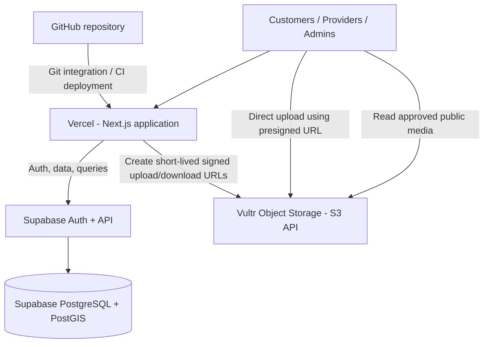

# Sri Lanka Local Services Finder
## Authoritative Architecture & Antigravity Development Directive — Vercel App + Vultr Object Storage Only

**Decision date:** 12 November 2026  
**Product:** Sri Lanka Local Services Finder  
**Development environment:** Google Antigravity  
**Hosting principle:** Use the fewest managed services possible; avoid servers and orchestration unless measured needs justify them.

---

## 0. This document is the source of truth

This document supersedes every earlier project instruction that says or implies that the application must migrate to Vultr Compute, Docker Compose, Caddy, Kubernetes, or a self-managed server. It also supersedes older V1/V2 descriptions that make Vultr Compute the planned production application host.

**Approved final direction:**

- **Application hosting, frontend, backend routes and deployment:** Vercel.
- **Database:** Supabase PostgreSQL.
- **Authentication:** Supabase Auth.
- **Geospatial search:** PostGIS in Supabase.
- **Object/file storage:** Vultr Object Storage only when the owner's promotional credits are confirmed to cover the subscription; otherwise use Supabase Storage until switching is economical.
- **Source control and deployment trigger:** GitHub connected to Vercel.
- **DNS:** Start with the Vercel-provided domain; add a custom domain when ready. Cloudflare DNS may be used later if needed.

**Do not provision Vultr Compute. Do not create a Kubernetes cluster. Do not introduce Docker, Docker Compose, Caddy, Nginx, Redis, a load balancer, or microservices for the MVP.** These are not requirements for the approved architecture.

If a previous document conflicts with this decision, follow this file and update the conflicting document or clearly mark it as superseded. Do not ask the owner to make the same hosting decision again.

---

## 1. Cost-first plan

### Development and internal testing

- Vercel Hobby may be used only while the project is a personal/non-commercial development or test project in accordance with Vercel's current terms.
- Supabase Free may be used for development and isolated test data.
- Do not commit to a recurring storage service unless there is a confirmed need.
- If Vultr credits are confirmed to cover Vultr Object Storage for the intended period, use it for application media. Otherwise, use Supabase Storage temporarily.

### Public commercial pilot / production

- Use an appropriate Vercel commercial plan. Vercel currently describes Pro at **US$20/month**, including US$20 of usage credit; verify current price, included usage and tax in the account before activation.
- Upgrade the Supabase project to a suitable paid plan before real customers depend on it. Supabase Free projects can pause after a week of low activity and have smaller database, egress and storage quotas.
- Use Vultr Object Storage only if account credits cover its subscription or the owner approves its recurring cost. Current published Standard Object Storage pricing is **US$18/month**, including 1,000 GB storage, 1,000 GB outbound transfer and unlimited inbound transfer; confirm the owner’s exact credit eligibility, taxes, location and terms in the Vultr console.
- Configure budget alerts and review actual invoices. Never assume promotional credits cover a product or overage unless confirmed in the owner's account.

Do not provision paid resources or upgrade plans without the owner's approval.

---

## 2. Target architecture



| Layer | Approved service | Responsibilities |
|---|---|---|
| Web app | Vercel + Next.js | Public website, customer area, provider dashboard, admin portal, server-side routes |
| Source | GitHub | Source control, branches, pull requests and review |
| Database | Supabase PostgreSQL | Users' application profiles, provider records, service listings, enquiries, reviews, moderation and audit data |
| Authentication | Supabase Auth | Login, signup, session management and password recovery |
| Geospatial | Supabase PostGIS | District/town/service-area and nearby search |
| File objects | Vultr Object Storage (optional based on credits) | Provider images, service portfolio images, logos and private verification documents |
| File metadata | Supabase PostgreSQL | Object key, owner, type, size, checksum, moderation status and access classification |
| Deployment | Vercel Git integration | Preview deployments and production deployment |

Keep the application as a **modular monolith**. Do not split it into microservices.

---

## 3. Storage decision and implementation

### 3.1 Use Vultr Object Storage, not Vultr Compute or block storage

Vultr is used only as S3-compatible object storage. Do not create a VM, Kubernetes cluster, file server or mounted block volume for uploads.

Use the Singapore Object Storage location where available. Read the exact S3 endpoint and credentials from the Vultr console after the owner provisions the storage subscription. Do not assume endpoint, signing region, ACL or CORS behaviour without validating the current Vultr documentation and account configuration.

The current published Standard tier is US$18/month for 1 TB storage and 1 TB outbound transfer. This is a fixed tier, not a tiny pay-as-you-go bucket. For a small prototype, Supabase Storage may be cheaper unless the Vultr promotional credits cover the subscription.

### 3.2 Storage abstraction is mandatory

Implement one provider-neutral interface, for example:

```ts
export interface StorageProvider {
  createUploadUrl(input: CreateUploadUrlInput): Promise<UploadUrlResult>;
  createDownloadUrl(input: CreateDownloadUrlInput): Promise<DownloadUrlResult>;
  deleteObject(input: DeleteObjectInput): Promise<void>;
  getObjectMetadata(input: GetObjectMetadataInput): Promise<ObjectMetadata | null>;
}
```

Implement only the adapter needed for the current environment. Prefer a `VultrS3StorageProvider` when Vultr credits are confirmed. Keep a `SupabaseStorageProvider` fallback possible without rewriting business features. Do not create two fully active storage backends or duplicate every upload unless the owner explicitly asks.

Select the implementation via server-only configuration, e.g. `STORAGE_PROVIDER=vultr` or `STORAGE_PROVIDER=supabase`.

Do not make storage-provider selection a browser-controlled input.

### 3.3 Buckets and access classes

Use separate buckets or equivalent isolated namespaces:

| Logical bucket | Access | Content |
|---|---|---|
| `lsf-public-media` | Public read only for approved objects | Approved provider profile photos, service portfolio images, business logos and category media |
| `lsf-private-files` | Private; server-authorized access only | Identity evidence, business registration, professional certificates, complaints and sensitive attachments |

Do not store identity documents in the public bucket. Do not enable public listing. Use random, non-guessable object keys; do not place NIC numbers, phone numbers, email addresses or other personal data in object keys.

Backups are not part of the MVP file-upload bucket. Use Supabase's plan backups and separately approved encrypted backup arrangements later. Do not put database dumps in the public media bucket.

### 3.4 Upload flow

1. User signs in and selects a file.
2. Browser sends a request to a Vercel server route to start an upload.
3. Server validates the session, role, ownership, permitted file class, file size, MIME type and upload rate limit.
4. Server creates a random object key and short-lived presigned upload URL using server-only Vultr S3 credentials.
5. Browser uploads directly to Vultr using that URL; file bytes do not pass through a Vercel function.
6. Browser calls a completion endpoint.
7. Server verifies object metadata (and checksum where supported), then writes the file metadata row to Supabase.
8. Public provider/service images remain pending moderation until approved. Private documents remain private.

Presigned URLs must be short-lived and restricted to one object key and expected method/content type where supported. Never expose access keys or secret keys in `NEXT_PUBLIC_*` variables or browser bundles.

### 3.5 Download flow

- Public approved media can use a public object URL or a CDN URL only after access/cache behaviour has been tested.
- Private files must be authorized by the server on every access and delivered using a short-lived presigned download URL.
- Do not cache private verification files in a public CDN.
- Ensure deleted, rejected or replaced media cannot remain publicly accessible through stale application references.

### 3.6 Upload security and efficiency

- Allowlist file extensions and actual MIME types; do not trust browser-supplied MIME alone.
- Set separate limits for avatars, portfolio images and private documents.
- Generate server-side object keys; never accept arbitrary bucket names or object paths from clients.
- Use signed upload URLs with narrowly scoped permissions and short expiry.
- Apply exact CORS origins for the actual Vercel domains and production domain; do not use wildcard origins with credentials.
- Compress/resize portfolio images before upload where appropriate and prefer modern formats such as WebP/AVIF when browser support and workflow permit.
- Strip unnecessary EXIF metadata from public images where practical.
- Rate-limit upload URL creation and completion endpoints.
- Add malware/content scanning for private documents before public release or admin use if required by risk review; at minimum keep private files quarantined until checked.
- Record object size, content type, checksum, uploader, timestamp, visibility and moderation state in Supabase.

---

## 4. Vercel application requirements

- Use Next.js App Router, React and TypeScript strict mode.
- Use standard Node.js-compatible server-side code. Do not use Vercel Edge Runtime for core business logic unless there is a measured reason.
- Use Vercel environment variables for all secrets and environment-specific settings.
- Separate Development, Preview and Production variables.
- Do not write user files to local filesystem; Vercel function filesystem is not durable application storage.
- Keep server-only credentials in server modules. Do not import secret-bearing modules into Client Components.
- Keep route handlers bounded and fast. Large file bytes must upload directly to object storage.
- Do not use Vercel Blob, KV, Postgres or other additional paid services unless separately approved.
- Do not rely on Vercel-specific APIs in core domain logic. Standard Next.js features are acceptable; storage is behind `StorageProvider`.

---

## 5. Supabase requirements

- Use Supabase PostgreSQL as the source of truth.
- Use migrations checked into Git; do not rely on manual dashboard-only schema changes.
- Enable PostGIS for geospatial queries.
- Use Supabase Auth and the current recommended SSR integration (`@supabase/ssr` plus `@supabase/supabase-js`); do not adopt deprecated auth-helper packages.
- Enforce Row Level Security on every exposed application table.
- Create explicit role and ownership policies for customer, provider, admin and support workflows.
- Never expose the service-role key to the browser.
- Maintain separate development/test and production Supabase projects when moving to a real public launch.
- Supabase stores file metadata and permissions; binary objects are stored in Vultr when that adapter is enabled.

---

## 6. Required repository structure

Adapt to the repository if it already exists. Do not destroy or regenerate existing working code without inspecting it first.

```text
local-services-finder/
├── AGENTS.md
├── PROJECT_BLUEPRINT.md
├── ANTIGRAVITY_ARCHITECTURE_VERCEL_VULTR_STORAGE_ONLY.md
├── ANTIGRAVITY_FIRST_PROMPT.md
├── package.json
├── next.config.ts
├── public/
├── supabase/
│   ├── migrations/
│   └── seed.sql
└── src/
    ├── app/
    │   ├── (public)/
    │   ├── (auth)/
    │   ├── customer/
    │   ├── provider/
    │   ├── admin/
    │   └── api/
    ├── components/
    ├── features/
    ├── lib/
    │   ├── supabase/
    │   ├── storage/
    │   │   ├── storage-provider.ts
    │   │   ├── storage-factory.ts
    │   │   └── providers/
    │   │       ├── vultr-s3-storage-provider.ts
    │   │       └── supabase-storage-provider.ts
    │   ├── auth/
    │   ├── permissions/
    │   ├── validation/
    │   └── security/
    ├── server/
    └── types/
```

The folder names are a guide, not a reason to create empty boilerplate. Keep modules cohesive and avoid needless abstraction outside the storage boundary.

---

## 7. Environment variables

Create `.env.example` with placeholders only. Do not commit real secrets.

```env
# Public application configuration
NEXT_PUBLIC_APP_URL=
NEXT_PUBLIC_SUPABASE_URL=
NEXT_PUBLIC_SUPABASE_ANON_KEY=

# Server-only Supabase credential: use only where strictly required
SUPABASE_SERVICE_ROLE_KEY=

# Select one storage implementation on the server
STORAGE_PROVIDER=vultr

# Vultr S3-compatible Object Storage — server only
VULTR_S3_ENDPOINT=
VULTR_S3_REGION=
VULTR_S3_ACCESS_KEY=
VULTR_S3_SECRET_KEY=
VULTR_PUBLIC_MEDIA_BUCKET=lsf-public-media
VULTR_PRIVATE_FILES_BUCKET=lsf-private-files
VULTR_PUBLIC_MEDIA_BASE_URL=

# Supabase Storage fallback — server only/configuration as needed
SUPABASE_PUBLIC_MEDIA_BUCKET=public-media
SUPABASE_PRIVATE_FILES_BUCKET=private-files
```

Rules:

- `VULTR_S3_ACCESS_KEY`, `VULTR_S3_SECRET_KEY` and `SUPABASE_SERVICE_ROLE_KEY` must never use the `NEXT_PUBLIC_` prefix.
- Do not hardcode endpoint or signing-region assumptions in source code; configure and validate them per Vultr bucket.
- Do not put private secrets in client components, logs, screenshots or GitHub commits.
- Vercel has separate Development, Preview and Production environments. Configure each deliberately.
- Use separate buckets/credentials for staging and production where practical.

---

## 8. Development milestones and acceptance gates

Build in increments. Complete and test each milestone before proceeding. Do not build the entire application in one unreviewed generation pass.

### M0 — Repository and deployment foundation

- Inspect current repo, dependencies, Git state and existing code.
- Confirm the project starts locally.
- Configure Next.js, TypeScript, linting, formatting and minimal tests.
- Connect GitHub to Vercel and deploy a working skeleton/health page.
- Add safe environment-variable validation.
- Deliver a README with local run and Vercel deploy instructions.

**Gate:** clean build, typecheck and lint; successful Vercel Preview deployment. No production secrets or paid resource provisioning.

### M1 — Database, authentication and authorization

- Add reviewed SQL migrations for core entities, Sri Lankan locations and service categories.
- Configure Supabase Auth.
- Implement user profiles and role model.
- Enable RLS and test cross-user access denial.
- Keep seed data fictional and clearly marked as test data.

**Gate:** migration succeeds on a fresh test project; customer/provider/admin permissions are tested; no role escalation.

### M2 — Customer discovery

- Responsive public homepage and category browsing.
- Search by service, district, town and location.
- Provider result cards and profile pages.
- Filters and pagination; empty, loading and error states.

**Gate:** mobile and desktop journeys work against test data; search does not leak private provider information.

### M3 — Provider portal and storage

- Provider onboarding and profile editing.
- Service catalog, service areas, opening hours and portfolio.
- Implement the `StorageProvider` interface.
- Integrate Vultr only after credit eligibility and bucket configuration are confirmed; otherwise use the Supabase adapter.
- Public/private bucket separation and signed URL tests.

**Gate:** an authorized provider can upload allowed portfolio media; one provider cannot edit another provider's objects; private files cannot be accessed by anonymous users or other providers.

### M4 — Administration and verification

- Admin role protection, provider review, document review, moderation, reporting and audit trail.
- Admin privileges must be server-verified and not based solely on client-controlled metadata.

**Gate:** role/permission tests and audit events pass.

### M5 — Marketplace transactions

- Service enquiries and request workflow.
- Provider responses and status updates.
- Contact methods and consent.
- Reviews only for traceable/eligible interactions.
- Notifications added behind a provider interface and only after choosing a cost-reviewed vendor.

**Gate:** customer/provider lifecycle tests and abuse controls pass.

### M6 — Pilot readiness

- Security review, accessibility, performance, SEO and responsive testing.
- Database backup and restore rehearsal.
- Media access and deletion tests.
- Vercel spend controls and Supabase/Vultr usage alerts.
- Legal/privacy review for Sri Lankan data-protection obligations before real customer launch.

**Gate:** release checklist signed off; no unresolved critical/high vulnerabilities.

### M7 — Growth

- Paid provider plans, promoted listings, business accounts, analytics and mobile applications only after validated demand.
- Reassess storage cost and hosting needs using real usage, not assumptions.

---

## 9. Explicit non-goals for the current architecture

Do not implement or provision the following for this project unless the owner explicitly approves a future architecture review:

- Kubernetes, managed Kubernetes or a cluster of any kind.
- Vultr Compute, VPS, bare metal or a self-hosted application server.
- Docker, Docker Compose, Caddy or Nginx as deployment dependencies.
- Self-hosted PostgreSQL, Redis or a message broker.
- Microservices or a distributed system.
- Vercel Blob or another second paid file-storage product while Vultr/Supabase storage is configured.
- Payment gateway, wallet, commission enforcement or live GPS tracking in the initial MVP.

---

## 10. Cost-control and owner approval rules

Before activating any paid resource or plan, show the owner:

1. Product/service and region.
2. Fixed monthly minimum.
3. Included storage, bandwidth, requests or usage.
4. Overage pricing and likely cost drivers.
5. Whether promotional credit is confirmed to apply.
6. How to disable or delete the resource to stop charges.

Set usage notifications and spend limits where available. Do not assume that a free allowance or credit will last indefinitely. Do not provision a resource merely because an SDK integration has been written.

---

## 11. Official references to verify during implementation

- Vercel pricing: https://vercel.com/pricing
- Vercel Hobby plan: https://vercel.com/docs/plans/hobby
- Vercel Pro plan: https://vercel.com/docs/plans/pro-plan
- Supabase pricing: https://supabase.com/pricing
- Supabase Storage pricing: https://supabase.com/docs/guides/storage/pricing
- Supabase project pausing: https://supabase.com/docs/guides/platform/free-project-pausing
- Vultr Object Storage: https://www.vultr.com/products/object-storage/
- Vultr Object Storage billing: https://docs.vultr.com/support/platform/billing/how-is-object-storage-billed
- Vultr Object Storage documentation: https://docs.vultr.com/product-overviews/object-storage

Always verify live prices and service compatibility before provisioning. The owner’s account billing and promotional-credit terms take precedence over published estimates.
