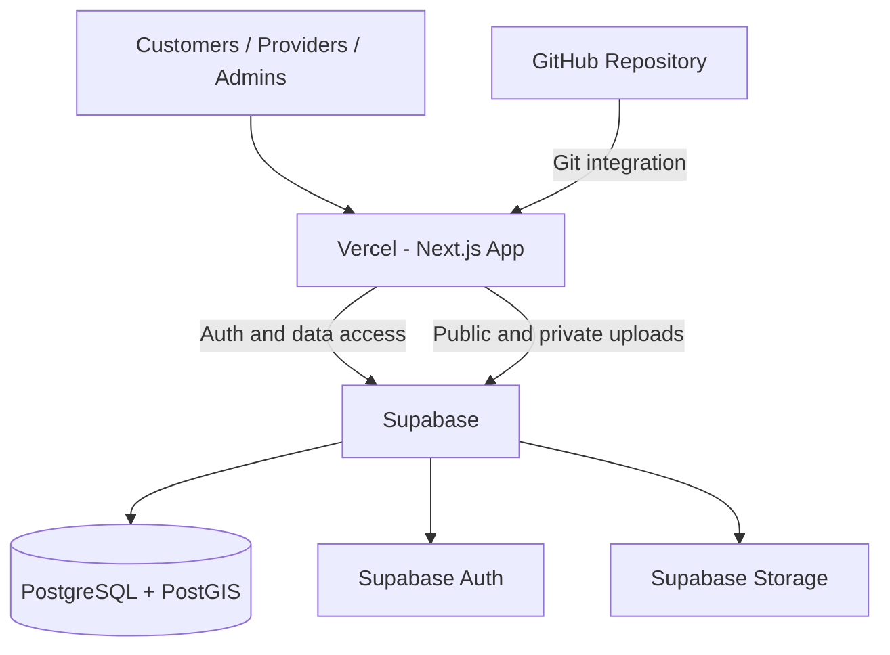
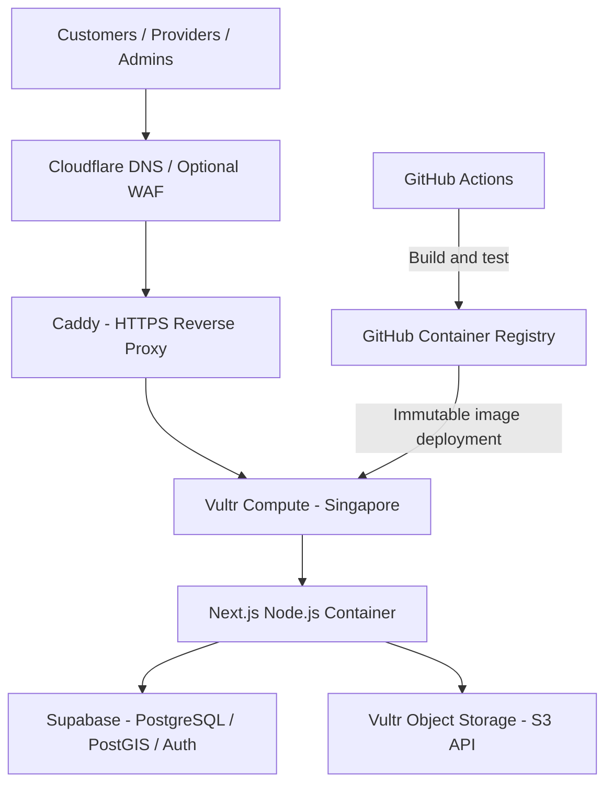

# Sri Lanka Local Services Finder
## Antigravity Implementation & Deployment Plan — V1 Vercel Testing → V2 Vultr Production

**Document type:** Authoritative implementation directive and staged infrastructure specification  
**Prepared:** 12 November 2026  
**Product:** Sri Lanka Local Services Finder  
**Development environment:** Google Antigravity  
**Source repository:** GitHub (private repository recommended)

---

## 0. Read this first — decision authority

This document updates the hosting and deployment sequence previously described in `PROJECT_BLUEPRINT.md`, `AGENTS.md`, `ANTIGRAVITY_FIRST_PROMPT.md`, `docs/INFRASTRUCTURE_DECISION.md` and `docs/DEPLOYMENT_RUNBOOK.md`.

**For any conflict about hosting, deployment, Docker or file storage, this document takes precedence.** The existing `PROJECT_BLUEPRINT.md` remains the primary source for product requirements, user roles, functional modules, database concepts, security requirements and marketplace rules. Keep those product requirements unless this document explicitly changes them.

### Approved staged decision

- **V1 — build, preview and test:** Deploy the Next.js application to **Vercel**. Use **Supabase** for PostgreSQL, PostGIS, authentication and file storage. Use GitHub for source control and Vercel's Git integration for deployments.
- **V2 — production infrastructure migration:** Move the Next.js application to **Vultr Cloud Compute in Singapore**, running **Docker Compose + Caddy**. Continue using Supabase for PostgreSQL, PostGIS and authentication. Move file storage from Supabase Storage to **Vultr Object Storage** using the S3-compatible adapter. Use GitHub Actions + GitHub Container Registry (GHCR) for container build and deployment. Use Cloudflare for DNS and, after validation, optional proxy/WAF.
- **Vultr credits:** Do not provision, resize or consume Vultr resources during V1 unless the owner separately instructs you to. Preserve the credits for the V2 migration and production services.
- **Docker:** Docker is **not part of the V1 Vercel deployment**. Prepare the application so it can run on standard Node.js. Introduce and validate the production Dockerfile, Compose file and Caddy configuration as part of the V2 readiness work, not as a blocker to V1 feature development.
- **Vercel is the V1 test host, not the final infrastructure commitment.** Do not describe the V1 deployment as the final public production launch.

Do not silently change these decisions. Record any proposed change in `docs/ARCHITECTURE_DECISIONS.md` and request owner approval before implementing it.

---

## 1. Product objective

Build a trustworthy, mobile-first local services discovery and enquiry marketplace for Sri Lanka.

**Product promise:** Find the right person. Get the job done.

The platform must help customers:

1. Find a suitable provider by service, category and location.
2. Understand what services a provider actually offers.
3. Compare public information, service areas, approved work samples and meaningful verification indicators.
4. Contact a provider or submit a service enquiry.
5. Review a provider only after an eligible, traceable platform interaction.

The platform must help providers:

1. Create and manage a provider profile.
2. List services and locations served.
3. Add portfolio images and public contact methods.
4. Receive and manage enquiries.
5. Submit supporting documents for human verification.

The administration system must support provider review, moderation, taxonomy, customer support, reporting, audit history and platform configuration.

Use `PROJECT_BLUEPRINT.md` for the full product scope, user roles, category concepts, service workflows, database concepts and non-goals. Do not invent fake providers, testimonials, reviews, ratings, prices, provider counts or verification outcomes.

---

## 2. Target architecture by version

### 2.1 V1 — Vercel testing architecture



| Concern | V1 service | V1 responsibility |
|---|---|---|
| Web application | Vercel | Next.js App Router, server rendering, route handlers and web delivery |
| Source control | GitHub | Private source repository, branches and pull requests |
| Database | Supabase PostgreSQL | Application records and migrations |
| Geospatial search | Supabase PostGIS | Nearby providers and service-area queries |
| Authentication | Supabase Auth | Customer, provider and administrator sign-in |
| File storage | Supabase Storage | Public approved media and private verification documents |
| Application monitoring | Sentry (optional) | Error reporting without sensitive personal data |
| DNS | Vercel-provided URL initially | Custom test domain may be connected later |

V1 must avoid infrastructure that is unnecessary for a test release. No Vultr Compute, Docker Compose, Caddy, self-hosted database, Kubernetes, Redis or microservices are required.

### 2.2 V2 — previously agreed Vultr production architecture



| Concern | V2 service | V2 responsibility |
|---|---|---|
| Application hosting | Vultr Cloud Compute, Singapore | Runs the Next.js application container |
| Container runtime | Docker Engine + Docker Compose | Reproducible application and proxy deployment |
| HTTPS / reverse proxy | Caddy | TLS termination and reverse proxy to Next.js |
| Database | Supabase PostgreSQL | Remains the application source of truth |
| Geospatial search | Supabase PostGIS | Remains unchanged |
| Authentication | Supabase Auth | Remains unchanged |
| File storage | Vultr Object Storage, Singapore | S3-compatible public and private object storage |
| CI/CD | GitHub Actions + GHCR | Build, test, publish immutable image tags and deploy |
| DNS / optional edge protection | Cloudflare | DNS and optional proxy/WAF after validation |
| Background processing | Separate worker only when required | Add only for a real workload |

Do not move PostgreSQL or authentication to the Vultr VM as part of V2. The previous plan uses managed Supabase for these services. Do not create a second database on the application server.

### 2.3 What changes from V1 to V2

Only infrastructure adapters and deployment configuration should need to change:

- Application hosting changes from Vercel to a Node.js container on Vultr.
- File storage changes from the Supabase Storage adapter to the Vultr S3-compatible adapter.
- CI/CD changes from Vercel Git deployments to GitHub Actions + GHCR + deployment to Vultr.
- HTTPS and DNS configuration changes to Caddy + Cloudflare.

The following must remain stable:

- Customer, provider and administrator user journeys.
- Domain/business logic and service rules.
- PostgreSQL schema and migrations.
- Supabase Auth and session semantics.
- PostGIS queries and location model.
- Public/private media metadata model.
- API contracts and validation rules wherever practical.
- Role, ownership, moderation and RLS policies.

Do not design a V1 feature that only works because of a Vercel-only product. V1 is hosted on Vercel, but core product logic must remain portable to ordinary Node.js hosting.

---

## 3. Technical stack

Use current stable versions that are compatible with one another. Before adding or upgrading a dependency, check its official documentation and the existing lockfile. Do not use deprecated Supabase auth-helper packages.

| Layer | Technology |
|---|---|
| Framework | Next.js App Router |
| Language | TypeScript, strict mode |
| UI | Tailwind CSS + shadcn/ui (or an existing consistent component system) |
| Forms | React Hook Form |
| Validation | Zod; validate on the server as well as the client |
| Authentication | Supabase Auth using `@supabase/ssr` and `@supabase/supabase-js` |
| Database | Supabase PostgreSQL |
| Geospatial | PostGIS extension in Supabase |
| V1 object storage | Supabase Storage |
| V2 object storage | Vultr S3-compatible Object Storage through an adapter |
| Tests | Vitest or the project's compatible unit-test framework; Playwright for key journeys |
| Source control | GitHub |
| V1 deployment | Vercel Git integration |
| V2 deployment | GitHub Actions + GHCR + Vultr Docker Compose |

Use the Node.js runtime for server functionality. Avoid relying on Edge Runtime for core business logic. Keep application code compatible with a normal Node.js production process.

---

## 4. Application structure

Use a modular monolith. Do not split the MVP into microservices.

Recommended starting structure (adapt to an existing repository rather than replacing it blindly):

```text
local-services-finder/
├── AGENTS.md
├── PROJECT_BLUEPRINT.md
├── ANTIGRAVITY_V1_VERCEL_V2_VULTR_PLAN.md
├── ANTIGRAVITY_FIRST_PROMPT.md
├── package.json
├── next.config.ts
├── tsconfig.json
├── middleware.ts                 # or supported Next.js proxy convention for chosen version
├── public/
├── src/
│   ├── app/
│   │   ├── (public)/
│   │   │   ├── page.tsx
│   │   │   ├── services/
│   │   │   ├── categories/
│   │   │   ├── locations/
│   │   │   └── providers/[slug]/
│   │   ├── (auth)/
│   │   │   ├── sign-in/
│   │   │   ├── sign-up/
│   │   │   └── auth/callback/
│   │   ├── customer/
│   │   ├── provider/
│   │   ├── admin/
│   │   ├── api/
│   │   ├── layout.tsx
│   │   └── globals.css
│   ├── components/
│   │   ├── ui/
│   │   ├── layout/
│   │   ├── search/
│   │   └── shared/
│   ├── features/
│   │   ├── auth/
│   │   ├── customers/
│   │   ├── providers/
│   │   ├── services/
│   │   ├── categories/
│   │   ├── locations/
│   │   ├── enquiries/
│   │   ├── reviews/
│   │   ├── verification/
│   │   ├── moderation/
│   │   └── notifications/
│   ├── lib/
│   │   ├── supabase/
│   │   ├── storage/
│   │   ├── auth/
│   │   ├── validation/
│   │   ├── rate-limit/
│   │   └── config/
│   ├── server/
│   │   ├── services/
│   │   ├── repositories/
│   │   └── policies/
│   ├── types/
│   └── i18n/
├── supabase/
│   ├── config.toml
│   ├── migrations/
│   └── seed.sql
├── docs/
├── tests/
├── .env.example
└── .gitignore
```

Do not place all business logic inside page components or route handlers. Pages should compose feature components; server services should enforce domain rules and permissions; repositories should handle persistence.

---

## 5. Core product modules

Build the product in stages. Each stage must be functional, not merely a collection of static screens.

### 5.1 Public customer experience

- Responsive home page.
- Search by service keyword.
- Browse service categories and subcategories.
- Select province, district and town.
- Nearby search where browser location permission is granted.
- Search results with provider name, service summary, supported areas and verified status only when approved.
- Filters and sorting that use real data.
- Provider detail pages with services, approved portfolio, contact options, service areas and eligible reviews.
- Clear no-results, loading and error states.
- SEO metadata and shareable provider/category URLs.

### 5.2 Customer accounts

- Sign-up, sign-in, sign-out and password/session recovery as supported by the selected Supabase Auth configuration.
- Profile and language preference.
- Own enquiry/request history.
- Saved providers/favourites.
- Eligible review submission.
- Privacy settings and account-deletion request flow.

Browsing public listings should not require an account. Require sign-in before submitting an enquiry containing personal contact details or submitting a review.

### 5.3 Provider onboarding and dashboard

- Register as an individual provider, sole proprietor or business.
- Create a public profile with public business/professional name, description and contact preferences.
- Select categories and offered services.
- Add service locations and coverage areas.
- Add service images and portfolio items.
- Add optional pricing information with clear labels (for example, starting price or quotation required).
- Configure availability only when it is actually supported.
- View and manage enquiries.
- Submit evidence for verification.
- Invite staff only after business membership and authorization rules are implemented.

Provider registration must not automatically publish a provider as verified. Pending profiles must be visibly pending and must follow the moderation rules in the base blueprint.

### 5.4 Administration

- Admin dashboard with meaningful counts derived from database records.
- Provider review queue.
- Verification evidence review with restricted access.
- Approve, reject or request additional information.
- Category, subcategory and service management.
- Province, district and town management.
- Customer and provider support tools.
- Review and report moderation.
- Audit log for sensitive actions.
- Role management restricted to authorized administrators.

Never hard-code dashboard metrics or create fake live activity.

### 5.5 Marketplace workflows

- Customer submits a service enquiry/request.
- Provider receives an enquiry and can update its status.
- Customer can view the status of their own request.
- Notifications are sent through replaceable adapters.
- Reviews are allowed only under the eligibility rules in the base blueprint.
- No in-app payment, escrow, commission settlement, live tracking or instant booking in the first test release unless the owner separately approves it.

---

## 6. Database and location design

Use Supabase PostgreSQL as the source of truth in both versions. Use versioned SQL migrations for every schema change. Do not make schema changes only through the Supabase dashboard.

Read the complete data model in `PROJECT_BLUEPRINT.md`. At minimum, plan for the following logical entities (final table names should be documented in `docs/DATABASE.md`):

- `profiles`
- `user_roles` or equivalent trusted role mapping
- `businesses` / provider profiles
- `business_memberships`
- `provider_services`
- `service_categories`
- `services` or subcategories
- `provinces`, `districts`, `towns` and/or normalized service locations
- `provider_service_areas`
- `provider_media`
- `verification_submissions`
- `verification_decisions`
- `enquiries` / service requests
- `enquiry_status_history`
- `reviews`
- `favourites`
- `reports`
- `notifications`
- `audit_logs`

### Location requirements

- Support all Sri Lankan provinces and districts, with town/locality records managed through seed/import data.
- Do not make up an exhaustive town list. Use a verified source and record provenance/date for imported location data.
- Store normalized location relationships, not free-text only.
- Use PostGIS `geography(Point, 4326)` or an explicitly documented equivalent for provider/service coordinates.
- Create appropriate GiST indexes.
- Use server-side PostGIS queries for nearby search; do not fetch all providers and calculate distance in the browser.
- Do not expose a provider's exact private home coordinates. Store public service locations or approximate display locations separately where needed.

### Database security

- Enable RLS on every exposed table.
- Write and test policies for every role and ownership relationship.
- Keep private verification records separate from public provider profile records.
- Do not rely on client-side hiding as authorization.
- Keep Supabase service-role/secret keys server-only; never put them in `NEXT_PUBLIC_*` variables.
- Audit privileged changes and verification decisions.

---

## 7. Storage abstraction — mandatory for V1 to V2 migration

V1 uses Supabase Storage. V2 uses Vultr Object Storage. The application must not call either provider's SDK directly from page components or domain business logic.

Create a provider-neutral interface such as:

```ts
export type StorageVisibility = "public" | "private";

export interface StorageObjectInput {
  bucket: string;
  path: string;
  contentType: string;
  sizeBytes: number;
}

export interface StorageService {
  createUploadUrl(input: StorageObjectInput): Promise<{
    uploadUrl: string;
    objectPath: string;
    expiresAt: string;
    requiredHeaders?: Record<string, string>;
  }>;
  createDownloadUrl(input: {
    bucket: string;
    path: string;
    expiresInSeconds: number;
  }): Promise<{ url: string; expiresAt: string }>;
  deleteObject(input: { bucket: string; path: string }): Promise<void>;
  getPublicUrl(input: { bucket: string; path: string }): string | null;
}
```

The interface may be adjusted to the actual provider SDK capabilities, but preserve the separation of concerns and document any differences.

### V1 storage implementation

- Implement `SupabaseStorageService`.
- Create separate Supabase buckets for approved public media and private documents.
- Public media can include approved provider logos, profile images, service images and portfolio images.
- Private media can include identity evidence, business registration, qualifications and complaint attachments.
- Private bucket access must be authorized and use short-lived signed URLs.
- Do not allow arbitrary anonymous uploads to public buckets.

### V2 storage implementation

- Implement `VultrS3StorageService` using the AWS S3 SDK-compatible client and Vultr's documented S3 API.
- Use separate Vultr buckets for public media, private documents and backups as appropriate.
- Keep all permanent Vultr keys on the server. Browser uploads use short-lived presigned URLs.
- Validate content, type, size and dimensions before finalizing metadata or making public assets available.
- Test CORS, signed URL expiry, upload confirmation, deletion and object retrieval against the selected Vultr region before migration.

### File metadata

Store file metadata in PostgreSQL, for example:

- owner/business ID
- storage provider identifier (where needed for migration)
- bucket and object path
- visibility
- content type and size
- upload state (pending, confirmed, rejected, deleted)
- moderation state
- created/updated timestamps

Avoid storing full permanent signed URLs in the database. Generate short-lived URLs when needed.

### Migration from V1 to V2 storage

- Build a one-off migration utility that enumerates approved and private objects from V1 storage.
- Copy objects to the corresponding V2 Vultr buckets while preserving stable object paths or updating metadata transactionally.
- Verify object counts, checksums/size and access policies.
- Keep V1 storage intact until verification and rollback windows are complete.
- Do not delete V1 objects automatically after copy.
- Produce a migration report and require owner approval before switching production reads/writes or deleting old files.

---

## 8. Authentication, roles and privacy

Use Supabase Auth with the currently supported SSR integration. Implement server-side session handling for Next.js.

Role and permission checks must be enforced in both server-side business logic and PostgreSQL RLS where applicable. A public user must never be able to grant themselves a provider, moderator or administrator role.

Protect at least these data classes:

1. Public service and provider information approved for display.
2. User profile data visible only to the account owner and authorized staff.
3. Customer enquiries and private contact details visible only to the customer, relevant provider members and authorized support staff.
4. Private verification documents visible only to designated verifiers and narrowly scoped administrators.
5. Audit and moderation records visible only to authorized administrators.

Use data minimization. Do not collect an identity document merely because the form can support it. Explain why a document is requested, who can access it and how long it is retained. Do not use actual sensitive identity documents during early technical tests.

---

## 9. Environment configuration

Maintain `.env.example` with placeholders only. Use separate values for local development, Vercel Preview/test and future V2 production. Do not commit `.env.local`, deployment secrets, database dumps or production environment files.

### V1 environment variables

Typical V1 variables (use the exact current Supabase key names issued by the project):

```env
NEXT_PUBLIC_APP_URL=http://localhost:3000
NEXT_PUBLIC_SUPABASE_URL=
NEXT_PUBLIC_SUPABASE_ANON_KEY=
# or the current Supabase publishable key, according to project configuration
SUPABASE_SERVICE_ROLE_KEY=
SUPABASE_STORAGE_PUBLIC_BUCKET=provider-public
SUPABASE_STORAGE_PRIVATE_BUCKET=private-documents
STORAGE_PROVIDER=supabase
```

Only values intended for browser use may use `NEXT_PUBLIC_`. `SUPABASE_SERVICE_ROLE_KEY` is server-only and must never be imported into client components or exposed to the browser.

### V2-only environment variables

Do not require these in V1. Add them when implementing the V2 S3 adapter and deployment:

```env
STORAGE_PROVIDER=vultr-s3
VULTR_S3_ENDPOINT=
VULTR_S3_REGION=
VULTR_S3_ACCESS_KEY=
VULTR_S3_SECRET_KEY=
VULTR_PUBLIC_MEDIA_BUCKET=
VULTR_PRIVATE_FILES_BUCKET=
VULTR_BACKUP_BUCKET=
VULTR_PUBLIC_MEDIA_BASE_URL=
```

The exact endpoint, signing region and bucket names must be confirmed from the selected Vultr account and region. Never assume a promotional credit covers a product or overage.

---

## 10. V1 Vercel deployment procedure

V1 is a test deployment. Do not call it the final public launch.

### Before deployment

1. Inspect the existing Git repository, branch, working tree and assets.
2. Confirm no secrets or sensitive records are committed.
3. Confirm the app builds locally with the production build command.
4. Confirm Supabase migrations apply to a non-production Supabase project.
5. Confirm RLS and storage access policies are tested.
6. Add a health route that returns minimal non-sensitive status information.
7. Add appropriate `noindex` metadata to the test deployment.
8. Ensure test/demo records are clearly marked and never represented as real providers or reviews.

### Vercel setup

1. Connect the private GitHub repository to a Vercel project.
2. Configure the correct Next.js framework settings (normally auto-detected).
3. Set Vercel environment variables separately for Preview and the test deployment.
4. Connect the Vercel test environment only to the non-production Supabase project.
5. Deploy from the agreed test branch.
6. Run smoke tests against the generated test URL.
7. Add a custom test subdomain only after DNS ownership and TLS are verified.
8. Keep test data isolated from any later production project.

### V1 release gate

The test deployment is acceptable only when:

- The Vercel build passes.
- Customer, provider and admin routes render correctly on mobile and desktop.
- Sign-in and sign-out work.
- Role and ownership checks work server-side and through RLS.
- Public provider listings cannot reveal private fields.
- Private files cannot be downloaded by an unauthorized account.
- Provider onboarding, listing and enquiry critical journeys pass.
- No fake ratings, reviews, prices or verification claims are visible.
- Error logs and analytics do not leak personal data or secrets.
- A documented rollback to the last known-good deployment exists.

Do not use real customer or provider identity documents for test data. Do not invite the public or advertise the test URL until the owner authorizes a public pilot and the applicable privacy/security review is complete.

### Vercel plan/commercial-use check

Before publishing a test deployment, verify the current Vercel plan terms against the actual use. Do not assume the Hobby plan permits a commercial marketplace. If the intended testing activity is commercial or public-facing and the Hobby terms do not permit it, use an appropriate paid plan. Record the plan and cost choice; do not purchase or upgrade a plan without the owner's approval.

---

## 11. V2 readiness and Vultr deployment procedure

V2 begins only after the V1 test release passes its acceptance criteria and the owner approves the migration.

### V2 readiness tasks

- Confirm application works in an ordinary Node.js production process.
- Confirm no core feature relies on Vercel-only products or Edge Runtime.
- Complete and test `StorageService` with both Supabase and Vultr adapters.
- Add a multi-stage production Dockerfile using a supported Node.js LTS image.
- Set Next.js `output: "standalone"` if compatible with the selected Next.js version and deployment approach.
- Add `compose.production.yaml` for the application and Caddy.
- Add `Caddyfile` for TLS and reverse proxy.
- Add Docker health checks and restart policies.
- Add `.dockerignore` and ensure secrets are excluded from image layers and build context.
- Add GitHub Actions workflow to lint, type-check, test, build and publish immutable SHA-tagged images to GHCR.
- Add a protected deployment workflow to Vultr. Store SSH and registry credentials only in GitHub Actions Secrets.
- Create and test backup, restore and rollback procedures.

### Vultr infrastructure

The previously approved V2 baseline is:

- Vultr Cloud Compute in Singapore, starting with a suitable Shared CPU instance (at least 2 GB RAM is the planning baseline; size after measuring the app).
- Ubuntu LTS.
- Docker Engine and Docker Compose plugin.
- One Next.js application container behind Caddy.
- Supabase remains the managed PostgreSQL/Auth/PostGIS service.
- Vultr Object Storage in Singapore for media and private files.
- Cloudflare DNS; enable proxy/WAF only after origin TLS, client IP and caching behaviour are tested.
- No Kubernetes, self-hosted PostgreSQL or Redis in the MVP.

Do not provision the instance or consume Vultr credits until the owner explicitly authorizes provisioning after reviewing the current account balance, expiry, eligible products and charges after credits expire.

### V2 deployment sequence

1. Create a separate V2 staging Supabase/storage environment or confirm a controlled migration plan.
2. Confirm Vultr credits, expiry, product eligibility, region and current charges in the user's account.
3. Provision Vultr Compute and Object Storage only after owner approval.
4. Harden SSH and firewall; expose only required web ports publicly.
5. Configure Caddy and HTTPS.
6. Build and publish the immutable Docker image through GitHub Actions and GHCR.
7. Deploy to V2 staging and run smoke, security and file-storage tests.
8. Migrate V1 media to Vultr Object Storage with checksums and a rollback window.
9. Switch the storage adapter using environment configuration after successful verification.
10. Run database backup and restore checks.
11. Obtain owner approval before moving DNS or directing real users to V2.
12. Keep the prior deployment and V1 files available during the agreed rollback period.

---

## 12. Milestones and Antigravity execution order

Antigravity must work one milestone at a time. It must present its plan, make changes only within the approved milestone, run checks and report evidence before moving on.

| Milestone | Scope | Deployment target | Completion evidence |
|---|---|---|---|
| M0 — Foundation | Inspect repo; scaffold or repair Next.js; establish design system; connect non-production Supabase; add health route and basic shell | Vercel test deployment | Successful build, URL, health check, repository summary |
| M1 — Database and auth | Migrations, seed taxonomy/location foundation, Supabase Auth SSR, roles, business membership and RLS | Vercel + dev Supabase | Migration output, auth tests, RLS tests |
| M2 — Customer discovery | Home, category browsing, search, location filters, provider search results and detail pages | Vercel | Responsive customer journeys using seeded demo data clearly labelled as demo |
| M3 — Provider platform | Onboarding, provider profile, services, service areas, portfolio and enquiry inbox | Vercel | Provider ownership and upload-access tests |
| M4 — Admin platform | Provider moderation, verification queue, taxonomy management, reports and audit logs | Vercel | Admin permission and audit tests |
| M5 — Marketplace flows | Enquiries, status changes, notifications adapter, favourites, eligible reviews and moderation | Vercel | End-to-end workflow tests |
| M6 — V1 test release | Security, accessibility, performance, responsive QA, PWA basics, SEO and test deployment | Vercel | V1 release checklist and test report |
| M7 — V2 portability | Vultr storage adapter, Dockerfile, Compose, Caddy, GH Actions, GHCR, migration and rollback documentation | Local/staging only | Docker build and staging smoke tests; no paid provisioning without approval |
| M8 — V2 deployment | Provision and deploy Vultr infrastructure; migrate media; validate; prepare production cutover | Vultr + Supabase | Owner-approved deployment and migration report |

### Rules for milestone completion

- Do not skip a milestone because generated UI appears complete.
- Do not implement the next milestone until the current milestone's acceptance criteria pass and the owner has reviewed the result.
- Every milestone must include: files changed, migrations added, tests run, test results, unresolved issues and next milestone recommendation.
- If credentials or a paid resource is needed, stop at the integration boundary and provide exact setup instructions. Never invent credentials.
- Antigravity must not claim a deployment, test or migration succeeded unless it actually ran and captured the result.

---

## 13. Quality, security and testing standards

### Required checks

Run applicable checks before each milestone is declared complete:

```bash
npm run lint
npm run typecheck
npm run test
npm run build
```

If a script does not exist, add an appropriate script or document why it is not applicable. Add Playwright tests for critical end-to-end journeys. Do not silence lint/type errors or weaken tests merely to obtain a green build.

### Security baseline

- Enforce RLS for all exposed tables.
- Check role, business membership and ownership on the server.
- Validate all external input with Zod on the server.
- Rate-limit authentication, enquiry, review, report and upload-session routes.
- Keep private documents in private buckets.
- Use short-lived signed access URLs for private files.
- Never expose service-role or Vultr credentials to the browser.
- Do not store uploaded files on local application disk.
- Do not log passwords, tokens, private contact details or sensitive document URLs.
- Audit administrator and verification decisions.
- Use separate development, V1 test and V2 production credentials/projects.
- Add clear loading, empty, error and success states.
- Use secure, accessible forms and keyboard-operable navigation.

### Seed data rules

- Seed only real taxonomy and verified administrative location references, with source provenance recorded.
- Demo provider profiles must be clearly identified as demo/test records and must not appear as real verified businesses.
- Never invent customer testimonials, provider reviews, star ratings, completed jobs, business registrations or qualifications.

---

## 14. UI and product experience guidance

The product is for a broad Sri Lankan audience. Build mobile-first and ensure it remains easy to use on low-to-mid-range Android phones and slower networks.

- Keep the interface clear and scannable; avoid long blocks of marketing text.
- Make service search and location selection prominent.
- Use readable typography, strong contrast and accessible controls.
- Support English initially while structuring all UI strings and database content for English, Sinhala and Tamil.
- Do not rely on colour alone to communicate verification or status.
- Explain what each verification label means.
- Do not expose a provider's exact residential location by default.
- Optimise image sizes and lazy-load non-critical imagery.
- Provide a useful fallback if browser geolocation is denied.
- Do not show fabricated availability or fixed prices where a quotation is required.

---

## 15. Required documentation to maintain

Antigravity must create or update these files as work progresses:

- `docs/IMPLEMENTATION_PLAN.md` — milestone status, tasks, dependencies and acceptance criteria.
- `docs/ARCHITECTURE_DECISIONS.md` — accepted decisions, alternatives and reasons.
- `docs/DATABASE.md` — schema, relationships, indexes, migrations and RLS policy summary.
- `docs/SECURITY.md` — threat considerations, secrets, authorization, storage and incident steps.
- `docs/INFRASTRUCTURE_DECISION.md` — V1/V2 architecture; must match this document.
- `docs/DEPLOYMENT_RUNBOOK.md` — V1 Vercel deployment and V2 Vultr deployment, clearly separated.
- `docs/TESTING.md` — test strategy, commands and latest verified results.
- `.env.example` — placeholders only, with comments explaining each variable.

Do not copy obsolete deployment instructions from earlier documents without reconciling them with this staged plan.

---

## 16. First task for Antigravity

When this document is supplied to Antigravity, **do not immediately generate the entire application**.

First:

1. Read `AGENTS.md`, `PROJECT_BLUEPRINT.md` and this document.
2. Inspect the repository, branch, working tree, existing code, package manager, lockfile and assets.
3. Identify and report conflicts in older Vercel/Vultr/Docker instructions. Apply this document's staged decision as the authority for infrastructure.
4. Summarise the current application state and anything worth preserving.
5. Create `docs/IMPLEMENTATION_PLAN.md`, `docs/ARCHITECTURE_DECISIONS.md` and `docs/INFRASTRUCTURE_DECISION.md` consistent with this plan.
6. Present the M0 task list, exact file changes, required environment variables and tests.
7. Do not provision services, request production secrets, create paid resources, or spend Vultr credits.
8. Stop for owner review before implementing M0 unless the owner has already explicitly approved M0 in the active instruction.

### M0 acceptance criteria

M0 is complete when:

- The Next.js application starts locally.
- TypeScript strict mode and linting are configured.
- A coherent initial design system and responsive shell exist.
- The non-production Supabase project can be connected through environment variables without exposing secrets.
- A health route works.
- The application builds successfully for Vercel.
- The GitHub repository is connected to a Vercel test project, or a precise manual setup checklist is provided if account access is unavailable.
- No Vultr resources have been provisioned and no Docker deployment has been introduced as a V1 dependency.

---

## 17. Final instruction

**Build V1 on Vercel for testing. Keep Supabase as the managed backend. Preserve portability. Move to the previously agreed Vultr Compute + Docker Compose + Caddy + Vultr Object Storage architecture only as V2, after V1 is tested and the owner approves the migration.**

Focus on a reliable marketplace, secure data handling and working customer/provider journeys. Do not let infrastructure complexity delay product development.
