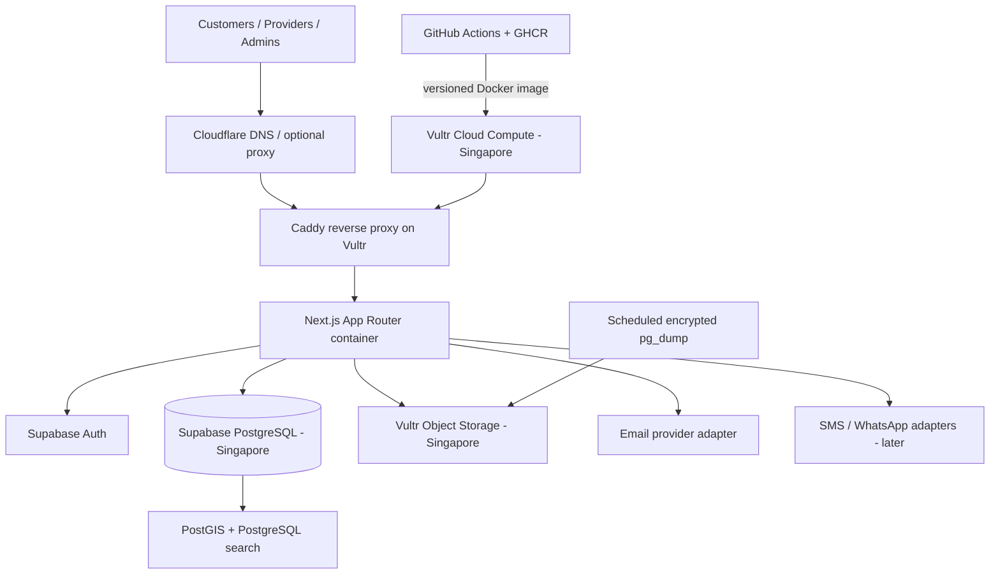

> **CURRENT HOSTING / STORAGE OVERRIDE (12 November 2026):** This file contains earlier infrastructure planning in some sections. For all hosting, deployment, Docker, server, Kubernetes and file-storage decisions, follow `ANTIGRAVITY_ARCHITECTURE_VERCEL_VULTR_STORAGE_ONLY.md`. The current decision is Vercel for the application, Supabase for PostgreSQL/PostGIS/Auth, and Vultr Object Storage only if promotional credits are confirmed to cover it. Do not provision Vultr Compute or Kubernetes. This note supersedes conflicting infrastructure passages below; product and functional requirements remain applicable.

# Sri Lanka Local Services Finder — Product & Technical Blueprint

**Document type:** Product requirements, architecture, database design, delivery plan and Antigravity implementation guide  
**Project status:** Greenfield / planning baseline  
**Initial market:** Sri Lanka  
**Primary delivery:** Responsive web application + Progressive Web App (PWA)  
**V1 testing hosting:** Vercel  
**V1 database / authentication / file storage:** Supabase (PostgreSQL, PostGIS, Auth and Storage)  
**V2 production hosting:** Vultr Cloud Compute (Docker Compose + Caddy)  
**V2 production file storage:** Vultr Object Storage (Singapore)  
**Development environment:** Google Antigravity  
**Proposed working name:** `Local Services Finder` (replace with final brand name before launch)

> **Staged infrastructure authority:** Read `ANTIGRAVITY_V1_VERCEL_V2_VULTR_PLAN.md`. That document controls all V1/V2 hosting, deployment, Docker and storage decisions. This blueprint remains the product and functional requirements source. When older infrastructure details in this blueprint conflict with the staged plan, follow the staged plan and update the conflicting documentation.

---

## 0. Instructions for the development agent

Treat this document as the product requirements source of truth. Treat `ANTIGRAVITY_V1_VERCEL_V2_VULTR_PLAN.md` as the authoritative infrastructure and deployment source of truth. Build the product in small, reviewable phases. Do not attempt to generate the entire marketplace in one pass.

Before writing implementation code:

1. Inspect the repository and report its current state.
2. Read this document and the root `AGENTS.md` file.
3. Create `docs/IMPLEMENTATION_PLAN.md` with milestones, dependencies, acceptance criteria and risks.
4. Create `docs/ARCHITECTURE_DECISIONS.md` and record material decisions before implementing them.
5. Identify any ambiguity that genuinely blocks implementation. Otherwise use the assumptions in this document and record the assumption.
6. Present the plan and wait for the developer to approve the first implementation phase.

During implementation:

- Use current stable versions of the chosen libraries. Do not blindly use deprecated examples from model memory.
- Check current official documentation when a library API or Vultr/Supabase/Vercel feature may have changed.
- Keep the codebase typed, modular, accessible, secure and easy to extend.
- Do not fabricate providers, ratings, reviews, verification badges, prices or customer activity. Clearly label all seed/demo records.
- Do not expose personal identity documents, private addresses, internal notes or private customer contact details in public queries.
- Do not claim that a provider is verified until a human administrator has completed and approved the relevant verification check.
- Do not mark a phase complete until tests and the acceptance criteria for that phase pass.

## 1. Product vision

Build a trusted Sri Lankan platform that helps people discover, compare and contact local service providers. It must support individual tradespeople, sole proprietors and registered businesses.

The product must be more than a searchable phone-number directory. It should make it easier to answer four questions:

1. Who provides this service in my area?
2. What work do they actually offer?
3. What evidence do I have that this provider is genuine and suitable?
4. How can I contact them or request the service?

### Product promise

**Find the right person. Get the job done.**

### Product principles

- Trust before listing volume.
- Useful local search before complex marketplace features.
- Clear provider information and transparent pricing where available.
- Customers can browse without creating an account.
- Provider onboarding should be simple on a mobile phone.
- Support English, Sinhala and Tamil from the data model onward.
- Do not expose exact private home locations by default.
- Do not charge customers to search or contact a provider in the initial release.
- Build the backend so native Android and iOS apps can be added later without replacing the database or business rules.

### Initial customer segments

- Households and renters.
- Homeowners and people moving house.
- Small and medium businesses.
- Vehicle owners.
- People seeking personal, education or event-related services.
- Visitors and foreign residents who need local services in Sri Lanka.

### Initial provider segments

- Individual skilled workers and tradespeople.
- Small local service businesses.
- Multi-person service companies.
- Independent professionals and consultants.

## 2. Product scope

### MVP — build now

1. Public home page and service discovery.
2. Category and subcategory browsing.
3. Search by service, district, town and optional current location.
4. Provider profile pages with service details, coverage areas, portfolio and contact choices.
5. Provider registration and onboarding wizard.
6. Provider dashboard to manage profile, services, locations, images and enquiries.
7. Customer enquiry / service request form.
8. Provider lead inbox and lead status management.
9. Manual provider verification workflow for administrators.
10. Reviews tied to a legitimate platform enquiry, with moderation.
11. Customer favourites.
12. Admin dashboard for providers, taxonomy, requests, reviews, reports and audit history.
13. Email notifications for important events; SMS/WhatsApp integration behind adapters and feature flags.
14. Responsive mobile-first interface and installable PWA basics.
15. English-first UI with data structures ready for Sinhala and Tamil; translate the complete customer journey before public islandwide launch.

### Later phases — do not build in the MVP unless separately approved

- In-app payments, escrow, refunds and provider payouts.
- Instant appointment scheduling and calendar synchronisation.
- Full real-time chat and voice/video calls.
- Live technician tracking.
- Native mobile apps.
- Automated identity-document verification.
- AI recommendations or automated provider matching.
- Subscription billing, lead credits and promoted placement payments.
- Franchise / multi-branch enterprise management.

### Explicit non-goals for MVP

- Do not become a classified-advertising site.
- Do not allow unlimited unmoderated provider listings.
- Do not guarantee the quality of a provider merely because they have a profile.
- Do not process customer payments or represent an enquiry as a confirmed booking.
- Do not scrape provider contact details from websites or social networks.

## 3. User roles and permissions

Use a role-based permission model. A person may be a customer and also belong to one or more provider businesses.

| Role | Description | Main permissions |
|---|---|---|
| Guest | Not signed in | Browse public categories and active provider profiles; search; view public reviews; start sign-in or enquiry flow |
| Customer | Signed-in service seeker | Manage own profile, submit enquiries, view own requests, favourite providers, submit eligible reviews and reports |
| Provider owner | Owns a provider business/profile | Manage own business, services, coverage, public contacts, images, verification submissions and team members; view own leads |
| Provider staff | Invited team member | Only the business functions explicitly granted by the owner |
| Moderator | Trust and safety operator | Review reported content and reviews; apply moderation actions within assigned scope |
| Verifier | Provider verification operator | Review submitted evidence and record verification decisions; cannot change billing or system settings |
| Administrator | Platform administrator | Manage taxonomy, accounts, providers, requests, moderation, configurations and users; all sensitive actions audited |
| Super administrator | Restricted owner-level operator | Manage administrator access, critical security settings and system-wide configuration |

### Authorization rules

- A role shown in a browser form is never proof of authority.
- Roles and business membership must be read and checked on the server and/or enforced through PostgreSQL Row Level Security (RLS).
- Never trust a role stored in user-editable metadata.
- Provider owners may only manage businesses for which they have an active membership with the required permission.
- Staff invitations must be accepted by the invited authenticated account.
- Administrator actions must create an audit-log record.
- Support access must be explicitly scoped and must not silently grant full administrator access.

## 4. Main application modules

### 4.1 Public discovery

- Home page with service search, category shortcuts and location selection.
- Category landing pages and subcategory pages.
- Provider search results in list view; map view may be enabled when a map provider is configured.
- Filters: category, district, town, service area, verification level, rating band, price indicator and availability (only when provider availability is implemented).
- Sorting: relevance, nearest, highest-rated (with a minimum review-count rule) and recently active.
- Provider profile with description, offered services, starting-price information, service coverage, public contact preferences, approved images and published reviews.
- SEO-friendly category, provider and location pages.

### 4.2 Customer accounts

- Email or mobile sign-in (select and configure the actual OTP provider before launch).
- Profile name and preferred language.
- Own enquiries and request history.
- Favourites.
- Review submission for eligible enquiries.
- Account and privacy settings.
- Request account closure and data deletion workflow, subject to legally required retention.

A customer account is not required to browse. Require authentication before submitting an enquiry that contains personal contact details or submitting a review.

### 4.3 Provider onboarding

Use a guided wizard with save-and-resume support:

1. Create account and verify contact channel.
2. Select provider type: individual, sole proprietor or registered business.
3. Enter public business / professional name and profile details.
4. Select primary categories and specific services.
5. Enter service locations: district, town and optional service radius/areas.
6. Add public contact methods and choose what may be displayed publicly.
7. Add portfolio photographs and a logo/profile image.
8. Optionally submit identity, registration or qualification evidence for verification.
9. Accept provider terms and privacy notices.
10. Submit profile for moderation.

Provider statuses: `draft`, `submitted`, `under_review`, `approved`, `rejected`, `suspended`, `archived`.

Only approved and active providers may appear in public results. Rejected applications must include an internal reason and a customer-safe explanation. A provider can correct and resubmit where allowed.

### 4.4 Provider dashboard

- Overview: profile completion, new enquiries, open leads and recent activity.
- Business profile editor.
- Service and category manager.
- Coverage area manager.
- Public contact and opening-hours settings.
- Portfolio / service image manager.
- Verification centre and evidence status.
- Enquiry / lead inbox with filters and status history.
- Review overview and right-to-reply workflow (provider response can be a later release).
- Team members and invitations (MVP can start with owner-only access but keep the schema ready).
- Account and notification settings.

### 4.5 Enquiry and service-request system

The MVP is an enquiry marketplace, not a payment or booking engine.

Two ways to make contact:

1. **Direct contact:** Customer uses the provider's published phone or WhatsApp action. Record an anonymous/aggregated contact-click event where lawful and disclosed; do not pretend that a click proves a call or job.
2. **Platform enquiry:** Customer submits a short request to a provider. The platform creates a lead, not a confirmed booking.

A multi-provider service request may be added as a controlled workflow: customer submits one request and explicitly chooses whether it may be shared with a limited set of relevant providers. Never broadcast personal contact details to every provider in a category.

Recommended lead statuses:

`new` → `viewed` → `contacted` → `quoted` → `accepted` → `in_progress` → `completed`

Alternative terminal statuses: `declined`, `cancelled`, `disputed`, `spam`.

All status changes must be validated against allowed transitions and recorded in a lead status history table. A lead is not a booking contract and must be labelled accordingly in the UI.

### 4.6 Reviews and reputation

- A review must reference a valid lead / service interaction.
- Default rule: one review per completed lead.
- Reviews have an overall 1–5 rating and an optional written comment.
- Optional dimensions: work quality, punctuality and communication.
- Reviews pass through a moderation state before publication.
- Customers may flag a review; providers may submit a response or dispute request.
- Do not allow providers or staff to review their own business.
- Do not permit paid providers to remove legitimate negative reviews.
- Show rating average and review count only from published reviews.
- Display “New provider” or “No reviews yet” rather than an invented rating.

### 4.7 Verification and trust

Use specific, evidence-based labels rather than one generic “verified” badge.

| Public label | Internal check required |
|---|---|
| Phone confirmed | A successful one-time contact verification |
| Identity checked | An authorised reviewer inspected an acceptable identity document and recorded the decision |
| Business details checked | Business registration / trading details reviewed where applicable |
| Qualification checked | Relevant qualification document or issuing source checked |
| Platform history | Completed platform leads and eligible reviews |

Verification records need: submitted type, storage reference, reviewer, decision, reason, checked date, expiry date (where appropriate) and audit history.

A document upload alone does not confer a badge. Public profile pages must never display identity-document numbers, full document images, dates of birth or other sensitive evidence.

### 4.8 Admin and moderation

Admin modules:

- Overview dashboard and operational metrics.
- Provider application queue.
- Provider profile and business management.
- Verification review queue.
- Service categories, tags and synonyms.
- Provinces, districts, towns and neighbourhood data.
- Enquiries and reported service issues.
- Review moderation and appeals.
- User account suspension / reinstatement.
- Reports and abuse cases.
- Static content / help pages / banners.
- Audit log viewer.
- System settings and notification templates.
- Subscription and payment administration (future feature only).

Sensitive admin actions require a confirmation step and a reason. Record actor, target, action, timestamp and relevant before/after metadata in `admin_audit_logs`.

## 5. Categories and Sri Lankan location model

### Recommended launch categories

Start with a controlled category tree. Do not launch hundreds of low-quality categories.

1. Home & Property
   - Plumbing
   - Electrical work
   - Air-conditioning repair and servicing
   - Cleaning
   - Pest control
   - Carpentry
   - Painting
   - Masonry and repairs
   - Roofing and waterproofing
   - Home renovation
2. Automotive & Transport
   - Vehicle mechanic
   - Auto electrician
   - Tyre and battery services
   - Vehicle detailing
   - Towing and roadside assistance
   - Moving and transport
3. Personal & Lifestyle
   - Salon and barber
   - Beauty services
   - Laundry and tailoring
   - Photography
   - Personal training
4. Education & Professional
   - Tuition
   - IT support
   - Design services
   - Accounting and tax services
   - Architecture and consulting
5. Business & Commercial
   - Office cleaning
   - CCTV and security installation
   - Commercial maintenance
   - IT maintenance
   - Equipment servicing
6. Events & Special Occasions
   - Photography and videography
   - Catering
   - Decoration
   - Event planning
   - Sound and lighting

Admin users must be able to add, rename, translate, reorder, deactivate and nest categories without a code deployment.

### Location hierarchy

Use structured location records, not free-text strings alone:

`Country → Province → District → Town / Locality → Optional neighbourhood`

Sri Lanka must be seeded with the nine provinces and twenty-five districts. Town/locality records should be curated and progressively expanded. Keep names and slugs in separate fields and support English, Sinhala and Tamil labels.

Each provider can serve:

- One or more selected towns/localities.
- An optional distance radius from a service base.
- An optional defined service polygon in a later phase.

Do not assume that the provider's business address and the location where the provider is willing to work are the same.

### Geolocation privacy

- Ask for browser location permission only when the user activates “Use my location”.
- Always provide manual district/town selection as an alternative.
- Store the minimum location precision needed for provider discovery.
- Do not publish the exact home coordinates of an individual tradesperson.
- Display town / service area by default; reveal a street-level address only when the provider explicitly chooses to publish a genuine business premises.

## 6. Search and ranking

### Search inputs

`q`, `category`, `subcategory`, `province`, `district`, `town`, `lat`, `lng`, `radiusKm`, `verifiedOnly`, `minRating`, `priceMode`, `sort`, `page`, `pageSize`.

### Search behaviour

- Search provider name, service title, service description, category and curated aliases.
- Support spelling variants and common local terminology.
- Support English, Sinhala and Tamil labels and curated synonyms.
- Treat Singlish / transliteration support as an iterative enhancement; do not claim complete transliteration coverage in the MVP.
- Provide helpful empty states and a “Post a service request” alternative.

### Suggested organic relevance factors

1. Exact category/service match.
2. Exact town match or distance within requested radius.
3. Match between requested service and provider service coverage.
4. Provider status is approved and active.
5. Relevant verification checks.
6. Published reviews and review count, with safeguards against tiny-sample distortion.
7. Profile completeness and recent provider activity.

Paid placements must be labelled “Sponsored” and kept distinct from organic ranking. Payment must not create a fake verification badge or fake review score.

Use PostgreSQL text search and `pg_trgm` for practical fuzzy matching. Use PostGIS for distance and area queries. For Sinhala/Tamil tokenisation, test real queries and maintain curated synonym tables; do not assume the default English text-search configuration handles every language well.

## 7. Final technical architecture — staged, cost-conscious and portable

### Architecture decision

The approved delivery sequence is **V1 testing on Vercel, followed by a V2 production infrastructure migration to the previously agreed Vultr architecture**. V1 uses Vercel for the Next.js application and Supabase for PostgreSQL, Auth, PostGIS and file storage. V2 moves the Next.js application to Vultr Cloud Compute in Singapore using Docker Compose + Caddy, retains Supabase for PostgreSQL/Auth/PostGIS and moves file storage to Vultr Object Storage. GitHub Actions + GHCR and Cloudflare are introduced for V2 as described in `ANTIGRAVITY_V1_VERCEL_V2_VULTR_PLAN.md`.

This section's detailed Vultr compute, Docker and object-storage configuration describes the **V2 target**, not an immediate V1 requirement. Do not provision Vultr resources or consume credits during V1. Docker is not a V1 deployment dependency. Keep the app portable to standard Node.js and implement a provider-neutral `StorageService` so the V1 Supabase Storage adapter can be replaced by the V2 Vultr S3 adapter without rewriting feature code.

### Architecture overview



### Platform responsibilities

| Layer | Selection | Responsibility |
|---|---|---|
| Application | Next.js App Router + React + TypeScript | Public website, customer area, provider portal and admin portal |
| Production runtime | Vultr Cloud Compute, Singapore | Runs the application container and reverse proxy |
| Container runtime | Docker Engine + Docker Compose | Reproducible deployment; no Kubernetes in the MVP |
| HTTPS / reverse proxy | Caddy | Automatic TLS and reverse proxy to the application container |
| CI/CD | GitHub Actions + GitHub Container Registry (GHCR) | Checks, builds, stores and deploys immutable image tags |
| Database | Supabase PostgreSQL, Singapore (`ap-southeast-1`) | Relational source of truth |
| Geospatial | PostGIS | Indexed nearby and service-area search |
| Authentication | Supabase Auth + `@supabase/ssr` | Cookie-based SSR authentication |
| File storage | Vultr Object Storage, Singapore (`sgp1.vultrobjects.com`) | Public approved media, private evidence and backups |
| Storage API | AWS SDK for JavaScript v3 | S3-compatible object operations and short-lived presigned URLs |
| UI | Tailwind CSS + shadcn/ui | Accessible responsive component system |
| Forms | React Hook Form + Zod | Client UX and server-side validation |
| Email | Resend or selected provider behind adapter | Transactional email |
| SMS / WhatsApp | Provider adapters, feature-flagged | OTP and notifications only after vendor selection |
| DNS / edge security | Cloudflare DNS; optional proxy after validation | DNS, web edge protection and traffic controls |
| Monitoring | Sentry + host monitoring + uptime checks | Error, performance and availability visibility |
| Testing | Vitest + Testing Library + Playwright | Unit, integration and end-to-end tests |

### Compute sizing and deployment shape

- Start with a Vultr Shared CPU Cloud Compute instance in Singapore with **at least 2 GB RAM** for the initial single-instance pilot. Treat 1 GB as development/test only; Next.js builds should happen in GitHub Actions, not on the production VM.
- Keep the production host simple: one Next.js container behind Caddy. Add a separate worker container only when a real background task requires it; initially it may run on the same VM but must be restartable independently.
- Do not run PostgreSQL, Redis, Supabase self-hosted, or Kubernetes on this first application VM. Supabase remains the managed database/Auth provider.
- Do not store user uploads or durable state on the VM filesystem. The VM must be replaceable from its Docker image and configuration.
- Add a second VM, managed queue or dedicated worker only when observed traffic or job volume justifies it.

### Supabase project and region

- Use a Supabase Free project for local development / non-production experimentation only.
- For a public pilot where customers rely on the service, use Supabase Pro or another explicitly approved production database arrangement. Supabase Free projects can pause after low activity over a seven-day period and do not provide downloadable database backups; this is not an acceptable default for a customer-facing production service.
- Create the production database in Singapore (`ap-southeast-1`) after measuring latency and reviewing the cross-border data handling implications for Sri Lankan users.
- Keep a separate development/staging project. Never test with live customer or verification data.
- Use migration files and Supabase CLI for every schema change. Enable and test RLS on every exposed table.

### Object storage layout and upload flow

Use a provider-neutral `StorageService` interface. The V1 adapter is Supabase Storage; the V2 adapter is Vultr's S3-compatible API. Do not call either storage SDK directly from page components or domain services. See `ANTIGRAVITY_V1_VERCEL_V2_VULTR_PLAN.md` for the migration rules.

Create separate buckets (or equivalent isolated policies):

1. `lsf-public-media` — only approved provider portraits, business logos, portfolio and service images. Public read is acceptable only for this bucket after the approval/processing step.
2. `lsf-private-files` — identity evidence, business registrations, qualifications, complaint evidence and temporary staging uploads. Keep private by default; never expose bucket listing or permanent public URLs.
3. `lsf-backups` — encrypted database dumps and operational backups. Private; restrict credentials to backup and restore processes.

Upload sequence:

1. Authenticated client asks the server to create an upload session.
2. Server checks role, ownership, file category, declared size, quota and rate limit; it generates a random object key and a short-lived presigned URL.
3. Browser uploads directly to Vultr over HTTPS. No permanent storage credentials are shipped to the browser.
4. Client calls the confirmation endpoint. Server performs `HeadObject`, checks actual size and metadata, and records the object in the database.
5. Images requiring moderation/processing remain in private staging. After validation, sanitisation and any required human approval, copy them to the public-media bucket.
6. Private documents are accessed only through authorised server checks and short-lived presigned GET URLs.

Validate actual file content, not only extension or browser-supplied MIME type. Use an allowlist (initially JPEG, PNG, WebP and PDF where appropriate), enforce per-category size limits, and reject HTML, executable files and SVG unless a specific sanitisation design is approved. Configure CORS for exact application origins only. Test the selected S3 SDK against Vultr's documented compatibility matrix before relying on multipart, ACL or presigned POST behaviours.

### Portability rules

- Set `output: "standalone"` in `next.config.ts` and maintain a multi-stage Dockerfile.
- The app must run with `node server.js` in a standard Node.js container.
- Use the Node.js runtime for routes that need server execution. Do not require Vercel Edge Runtime.
- Do not use Vercel Blob, Vercel KV, Vercel Postgres, Vercel Cron, Edge Config or other Vercel-only services in core product paths.
- Do not assume a writable or persistent application filesystem. Use object storage for files and the database for state.
- Keep storage access behind `StorageService`; keep email, SMS, maps and CAPTCHA behind adapters.
- Do not put secrets in `NEXT_PUBLIC_` variables. Only intentionally public Supabase URL/publishable key and browser-restricted public map key may use that prefix.
- Build once into a versioned OCI image and deploy the same artifact through staging and production. Configuration is supplied at runtime except for public variables that Next.js statically inlines; those must be passed as documented build arguments and are not secrets.
- Avoid dependencies on Vercel-specific headers, runtime, filesystem behaviour or deployment APIs. If Vercel Pro is selected in the future, the same Node-compatible app must pass its deployment smoke tests.

### Initial project bootstrap

For a new empty repository, use the current supported Next.js App Router + TypeScript setup. Add Supabase SSR with `@supabase/ssr`; do not use deprecated auth-helper packages. Choose exactly one package manager and commit its lockfile.

Expected core packages include `@supabase/supabase-js`, `@supabase/ssr`, `zod`, `react-hook-form` and `@hookform/resolvers`. Add `@aws-sdk/client-s3` and `@aws-sdk/s3-request-presigner` for Vultr Object Storage. Add `sharp` only if server-side image processing is required and validated in the chosen container base image. Add mapping, email, analytics and bot-protection packages only when integrations are selected.

### Cost and plan guardrails

- Use local Docker and Supabase Free for development. Supabase Free currently includes 500 MB database, 1 GB file storage and 5 GB egress; projects may pause after a week of low activity. Do not treat these allowances as production guarantees.
- Use Vultr credits for the first compute and object-storage charges only after checking the credit's expiry, product eligibility and account billing view. Never assume credits cover every product, tax or overage.
- Vultr Object Storage Standard currently starts at $18/month and includes 1 TB storage plus 1 TB outbound transfer; inbound transfer is included. This may be more capacity than the MVP needs, so use it during the credit period only if the credits actually cover the subscription. Re-check price and included usage before provisioning.
- Supabase Pro currently starts at $25/month for one project and is the planned production database/Auth budget line. Verify current pricing and regional availability before launch.
- Avoid paid Vercel, Kubernetes, managed Redis, load balancers and multiple production instances until measured need justifies them.
- Add spend alerts for Vultr, Supabase, domain/DNS, email, maps and messaging. Review actual credit consumption monthly.

### Vercel as a future option

Vercel is not the baseline production host. It may be adopted later if reduced operations work, deployment previews or measured performance justify the monthly cost. The Hobby plan is limited to personal/non-commercial usage and must not host this commercial marketplace. Any switch to Vercel production requires a paid commercial plan, usage estimate, region check and end-to-end deployment test. Docker/Vultr remains the portable fallback.

## 8. Repository and folder structure

Use a single Next.js application initially. Do not introduce microservices or a monorepo until there is a concrete need.

```text
local-services-finder/
├── AGENTS.md
├── PROJECT_BLUEPRINT.md
├── README.md
├── package.json
├── pnpm-lock.yaml                 # or npm lockfile; choose one package manager
├── next.config.ts
├── tsconfig.json
├── eslint.config.mjs
├── postcss.config.mjs
├── components.json
├── .env.example
├── .gitignore
├── Dockerfile
├── compose.production.yaml
├── Caddyfile
├── .dockerignore
├── .github/
│   └── workflows/                 # CI and Vultr deployment workflows
├── docs/
│   ├── INFRASTRUCTURE_DECISION.md
│   ├── DEPLOYMENT_RUNBOOK.md
│   ├── IMPLEMENTATION_PLAN.md
│   ├── ARCHITECTURE_DECISIONS.md
│   ├── SECURITY.md
│   └── DATABASE.md
├── public/
│   ├── icons/
│   ├── images/
│   ├── manifest.webmanifest
│   └── locales/                   # if static locale assets are used
├── src/
│   ├── app/
│   │   ├── (public)/
│   │   │   ├── page.tsx
│   │   │   ├── search/page.tsx
│   │   │   ├── services/[categorySlug]/page.tsx
│   │   │   ├── providers/[providerSlug]/page.tsx
│   │   │   ├── locations/[districtSlug]/[townSlug]/page.tsx
│   │   │   ├── how-it-works/page.tsx
│   │   │   ├── safety/page.tsx
│   │   │   ├── about/page.tsx
│   │   │   ├── contact/page.tsx
│   │   │   ├── privacy/page.tsx
│   │   │   └── terms/page.tsx
│   │   ├── (auth)/
│   │   │   ├── sign-in/page.tsx
│   │   │   ├── sign-up/page.tsx
│   │   │   ├── auth/callback/route.ts
│   │   │   └── verify/page.tsx
│   │   ├── (customer)/account/
│   │   │   ├── page.tsx
│   │   │   ├── enquiries/page.tsx
│   │   │   ├── favourites/page.tsx
│   │   │   └── settings/page.tsx
│   │   ├── (provider)/provider/
│   │   │   ├── onboarding/page.tsx
│   │   │   ├── dashboard/page.tsx
│   │   │   ├── profile/page.tsx
│   │   │   ├── services/page.tsx
│   │   │   ├── service-areas/page.tsx
│   │   │   ├── enquiries/page.tsx
│   │   │   ├── verification/page.tsx
│   │   │   └── settings/page.tsx
│   │   ├── (admin)/admin/
│   │   │   ├── page.tsx
│   │   │   ├── providers/page.tsx
│   │   │   ├── verifications/page.tsx
│   │   │   ├── categories/page.tsx
│   │   │   ├── locations/page.tsx
│   │   │   ├── enquiries/page.tsx
│   │   │   ├── reviews/page.tsx
│   │   │   ├── reports/page.tsx
│   │   │   ├── users/page.tsx
│   │   │   └── audit-logs/page.tsx
│   │   ├── api/v1/
│   │   │   ├── search/providers/route.ts
│   │   │   ├── providers/[slug]/route.ts
│   │   │   ├── categories/route.ts
│   │   │   ├── locations/route.ts
│   │   │   ├── provider-applications/route.ts
│   │   │   ├── leads/route.ts
│   │   │   ├── reviews/route.ts
│   │   │   ├── reports/route.ts
│   │   │   └── admin/                  # protected admin endpoints
│   │   ├── layout.tsx
│   │   ├── globals.css
│   │   ├── error.tsx
│   │   ├── not-found.tsx
│   │   ├── robots.ts
│   │   └── sitemap.ts
│   ├── components/
│   │   ├── ui/
│   │   ├── layout/
│   │   ├── navigation/
│   │   ├── search/
│   │   ├── categories/
│   │   ├── providers/
│   │   ├── leads/
│   │   ├── reviews/
│   │   ├── forms/
│   │   └── admin/
│   ├── features/
│   │   ├── auth/
│   │   ├── accounts/
│   │   ├── catalog/
│   │   ├── discovery/
│   │   ├── provider-onboarding/
│   │   ├── provider-management/
│   │   ├── locations/
│   │   ├── leads/
│   │   ├── verification/
│   │   ├── reviews/
│   │   ├── moderation/
│   │   └── notifications/
│   ├── lib/
│   │   ├── supabase/client.ts
│   │   ├── supabase/server.ts
│   │   ├── supabase/middleware.ts
│   │   ├── auth/
│   │   ├── permissions/
│   │   ├── validation/
│   │   ├── geo/
│   │   ├── search/
│   │   ├── notifications/
│   │   ├── rate-limit/
│   │   ├── security/
│   │   ├── seo/
│   │   └── utils/
│   ├── types/
│   ├── config/
│   └── styles/
├── supabase/
│   ├── config.toml
│   ├── migrations/
│   ├── seed.sql
│   └── tests/
├── tests/
│   ├── unit/
│   ├── integration/
│   └── e2e/
└── docs/
    ├── IMPLEMENTATION_PLAN.md
    ├── ARCHITECTURE_DECISIONS.md
    ├── DATABASE.md
    ├── API.md
    ├── SECURITY.md
    └── RELEASE_CHECKLIST.md
```

Keep domain rules in `src/features` / server-side services. Keep reusable visual components in `src/components`. Avoid putting business logic inside page components.

## 9. Database design

Use UUID primary keys unless there is a measured reason not to. Add `created_at`, `updated_at` and appropriate indexes. Use migrations for every schema change. Store timestamps in UTC; display in `Asia/Colombo`.

### 9.1 Core tables

| Table | Purpose | Important columns |
|---|---|---|
| `profiles` | Personal account profile | `id` references `auth.users`, `display_name`, `phone`, `email`, `preferred_locale`, `avatar_path`, `account_status` |
| `user_roles` | Platform-wide roles | `user_id`, `role`, `granted_by`, `created_at` |
| `businesses` | Individual or company provider profile | `id`, `owner_id`, `business_type`, `name`, `slug`, `description`, `status`, `public_phone`, `public_whatsapp`, `public_email`, `website_url`, `published_at` |
| `business_members` | Owner/staff access to a provider business | `business_id`, `user_id`, `member_role`, `permissions`, `status`, `invited_by` |
| `service_categories` | Category tree | `id`, `parent_id`, `slug`, `name_en`, `name_si`, `name_ta`, `description_*`, `icon`, `sort_order`, `is_active` |
| `service_category_aliases` | Search synonyms / local variants | `category_id`, `locale`, `alias`, `normalized_alias` |
| `provider_services` | Services offered by a business | `id`, `business_id`, `category_id`, `title`, `description`, `pricing_type`, `price_min`, `price_max`, `currency`, `is_active` |
| `provinces` | Sri Lankan provinces | `id`, `slug`, translated names |
| `districts` | Sri Lankan districts | `id`, `province_id`, `slug`, translated names |
| `localities` | Towns and neighbourhoods | `id`, `district_id`, `parent_locality_id`, `slug`, translated names, optional centre point |
| `provider_service_areas` | Town/radius/area coverage | `id`, `business_id`, `locality_id`, `radius_km`, `coverage_type`, optional geography polygon, `is_active` |
| `provider_media` | Approved public media references | `id`, `business_id`, `storage_path`, `media_type`, `alt_text_*`, `sort_order`, `moderation_status` |
| `verification_submissions` | Private verification evidence and review state | `id`, `business_id`, `submitted_by`, `check_type`, `private_storage_path`, `status`, `reviewer_id`, `decision_reason`, `checked_at`, `expires_at` |
| `leads` | Customer enquiry to provider | `id`, `customer_id`, `business_id`, `provider_service_id`, `category_id`, `message`, `customer_name_snapshot`, `customer_contact_snapshot`, `location_id`, `preferred_date`, `status`, `source` |
| `lead_status_events` | Immutable lead state history | `id`, `lead_id`, `changed_by`, `from_status`, `to_status`, `note`, `created_at` |
| `service_requests` | Optional customer request shared with selected providers | `id`, `customer_id`, `category_id`, `description`, `locality_id`, `location_point` (private), `budget_min`, `budget_max`, `status`, `share_scope` |
| `service_request_recipients` | Tracks which providers receive a request | `id`, `request_id`, `business_id`, `delivery_status`, `responded_at` |
| `reviews` | Customer reviews | `id`, `lead_id`, `business_id`, `customer_id`, `rating`, `quality_rating`, `punctuality_rating`, `communication_rating`, `comment`, `status`, `published_at` |
| `review_reports` | Review flags and moderation requests | `id`, `review_id`, `reported_by`, `reason`, `status`, `moderator_id` |
| `favourites` | Saved providers | `customer_id`, `business_id`, `created_at` |
| `user_notifications` | In-app notifications | `id`, `user_id`, `type`, `title`, `body`, `payload`, `read_at`, `created_at` |
| `notification_deliveries` | Email/SMS/WhatsApp delivery attempts | `id`, `user_id`, `channel`, `template_key`, `provider_message_id`, `status`, `attempted_at`, `error_code` |
| `abuse_reports` | Platform safety reports | `id`, `reporter_id`, `target_type`, `target_id`, `reason`, `description`, `status`, `assigned_to` |
| `admin_audit_logs` | Sensitive admin action history | `id`, `actor_id`, `action`, `target_type`, `target_id`, `before_data`, `after_data`, `reason`, `created_at` |
| `contact_events` | Privacy-minimised contact interaction events | `id`, `business_id`, `channel`, `event_day`, optional coarse source metadata |

### 9.2 Future tables

Add only when their features are approved:

- `appointments`, `booking_status_events`.
- `conversations`, `conversation_members`, `messages`, `message_attachments`.
- `subscription_plans`, `business_subscriptions`, `billing_events`.
- `payment_intents`, `payment_transactions`, `refunds`, `provider_payouts`.
- `business_branches`, `staff_availability`, `service_areas_polygons`.

### 9.3 Important database rules

- `profiles.id` must match `auth.users.id`.
- A business must have an owner and an active owner membership.
- A business slug must be unique and URL-safe.
- Only approved active businesses and active services can appear in public search.
- A review must reference a completed eligible lead; enforce uniqueness to prevent multiple reviews for one lead unless an explicit dispute workflow allows replacement.
- Store prices as `numeric`, not floating-point. Store currency as ISO code; MVP defaults to `LKR`.
- `price_min` must not exceed `price_max`.
- Use enums or constrained text values for statuses.
- Use a dedicated private schema or non-exposed tables for private verification and personal data where appropriate.
- Use PostGIS geography points for proximity search and GiST spatial indexes. Install PostGIS in a dedicated `extensions` schema, not `public`.
- Never rely only on frontend filtering to protect records.

### 9.4 Search indexing

Create indexes for:

- Provider status and slug.
- Active service category and business ID.
- Business/service text search vector.
- Trigram indexes on selected names and titles for fuzzy matching.
- `provider_service_areas.locality_id` and business ID.
- Spatial GiST indexes on provider location / service area geometry.
- Lead business ID, customer ID, status and creation date.
- Reviews business ID, status and publication date.
- Foreign keys used by dashboard list pages.

Avoid returning full database records for public search. Create a public-safe query/view or RPC that returns only approved fields.

## 10. Row Level Security and storage policy design

Enable RLS on every table exposed through Supabase's Data API. Write explicit policies and test them with anonymous, customer, provider-owner, staff and admin accounts.

### Public / anonymous access

Allowed:

- Read active category and location catalogue records.
- Read public-safe details of approved and active provider businesses.
- Read active provider services, public coverage labels, approved public media and published reviews.

Not allowed:

- Read provider identity documents or verification notes.
- Read private addresses or exact private coordinates.
- Read leads, customer contact data, unpublished reviews, reports or admin logs.
- Read suspended/rejected/draft provider records.

### Customer access

- Read and update their own profile.
- Create and read their own leads / service requests.
- Read their own notifications, favourites and eligible review records.
- Update/delete their own data only where the business rules and retention policy permit.
- Cannot read another customer's enquiries or private contact details.

### Provider access

- Read and update only businesses to which the authenticated user has an active membership with the correct permission.
- Read leads delivered to their business only.
- Update only the allowed lead fields/status transitions.
- Upload only to approved business media paths.
- Read their own verification status, but not unrestricted reviewer notes or internal fraud signals.

### Admin access

- Use server-side permission checks in addition to database controls.
- Restrict super-admin privileges to a very small group.
- Log every sensitive change.
- Do not place an elevated Supabase secret/service-role key in client code or a `NEXT_PUBLIC_` variable.

### Vultr Object Storage buckets

Supabase RLS protects the database records that refer to objects; Vultr bucket policy/CORS and the server-side `StorageService` protect the objects themselves. Do not assume Supabase RLS automatically protects Vultr files.

1. `lsf-public-media` — public read only for approved images; no public bucket listing. Objects enter this bucket only after server validation and any required moderation.
2. `lsf-private-files` — private verification evidence, qualification/business documents, complaint evidence and private staging uploads. Issue short-lived download URLs only after server-side authorization.
3. `lsf-backups` — private encrypted database backups; separate credentials and retention rules.

Use random opaque object keys and store bucket/key metadata in PostgreSQL. Validate actual bytes, MIME type, size and image dimensions. Never use a user-supplied filename as the object key. Malware scanning should be added before reviewers download untrusted documents.

## 11. API design

Use a versioned API namespace: `/api/v1`. Keep server-side business logic in feature service modules so the same logic can later be used by mobile applications.

### Public endpoints

| Method | Route | Purpose |
|---|---|---|
| GET | `/api/v1/search/providers` | Search active public providers |
| GET | `/api/v1/categories` | Read category tree and translated labels |
| GET | `/api/v1/locations` | Search provinces, districts and localities |
| GET | `/api/v1/providers/[slug]` | Public-safe provider profile |

### Authenticated customer endpoints

| Method | Route | Purpose |
|---|---|---|
| POST | `/api/v1/leads` | Create a provider enquiry |
| GET | `/api/v1/me/leads` | List the signed-in customer's leads |
| POST | `/api/v1/favourites` | Add/remove favourite |
| POST | `/api/v1/reviews` | Submit review for eligible completed lead |
| POST | `/api/v1/reports` | Report a provider, review or user |

### Provider endpoints

| Method | Route | Purpose |
|---|---|---|
| POST | `/api/v1/provider-applications` | Submit initial provider application |
| PATCH | `/api/v1/provider/business` | Update own business profile |
| POST | `/api/v1/provider/services` | Add or update a service |
| POST | `/api/v1/provider/service-areas` | Add coverage area |
| GET | `/api/v1/provider/leads` | List leads for a provider business |
| PATCH | `/api/v1/provider/leads/[id]` | Update allowed lead status |
| POST | `/api/v1/provider/media` | Request a protected media upload |
| POST | `/api/v1/provider/verifications` | Submit verification evidence |

### Admin endpoints

- `/api/v1/admin/providers`
- `/api/v1/admin/verifications`
- `/api/v1/admin/categories`
- `/api/v1/admin/locations`
- `/api/v1/admin/reviews`
- `/api/v1/admin/reports`
- `/api/v1/admin/users`
- `/api/v1/admin/audit-logs`

Every admin route must verify the user's role server-side and check that the requested action is permitted. Never protect admin routes only by hiding a menu item.

### API response pattern

Use a consistent response envelope:

```json
{
  "data": {},
  "meta": {
    "requestId": "server-generated-id"
  },
  "error": null
}
```

For errors:

```json
{
  "data": null,
  "meta": {
    "requestId": "server-generated-id"
  },
  "error": {
    "code": "VALIDATION_ERROR",
    "message": "Please check the submitted information.",
    "fieldErrors": {}
  }
}
```

Do not send SQL errors, stack traces, private storage paths or secrets to clients.

## 12. User journeys and page requirements

### Customer journey

1. Visit home page without signing in.
2. Search by service name or choose a category.
3. Choose district/town or explicitly allow location access.
4. Review a list of matching providers.
5. Apply filters and compare profiles.
6. Open a provider profile.
7. Call / WhatsApp using a provider-published contact option, or submit a platform enquiry.
8. Receive a confirmation and view enquiry history after sign-in.
9. Provider marks the lead completed; customer becomes eligible to review.

### Provider journey

1. Select “List your service”.
2. Register/sign in.
3. Complete the provider onboarding wizard.
4. Submit for review.
5. Receive status updates and fix any requested details.
6. Once approved, public profile becomes searchable.
7. Receive enquiries and manage lead statuses.
8. Build reputation through genuine completed-job reviews.

### Admin journey

1. Review pending applications.
2. Inspect public profile content and private submitted evidence in a restricted workflow.
3. Approve, reject or request correction.
4. Moderate public media and reviews.
5. Handle reports and complaints.
6. Review audit history for sensitive actions.

### Public home page sections

- Header: logo, service search, location, language, sign-in, “List your service”.
- Hero: “Find a trusted service near you” with service and location inputs.
- Popular service categories.
- How it works.
- Local service discovery / location shortcuts.
- Trust and verification explanation.
- Provider onboarding call-to-action.
- Footer with safety, privacy, terms and contact links.

Do not make the home page a long marketing article. Use clear category cards, concise descriptions and strong search affordances.

### Provider profile layout

- Business / professional name and accurate verification labels.
- Profile photograph/logo and approved portfolio gallery.
- Service categories and detailed service cards.
- Service locations / areas covered.
- Short description and experience information supplied by provider.
- Price indicator or “Request a quote”.
- Public contact buttons according to provider consent.
- Published rating and review count, or “No reviews yet”.
- Report profile action.

## 13. Design and accessibility system

Build a coherent, mobile-first marketplace UI. Do not generate a generic admin template and reuse it everywhere.

### Visual direction

- Clean, trustworthy, modern and practical.
- Light neutral background with a dark readable text colour and one confident accent colour.
- Avoid excessive gradients, glassmorphism, huge empty hero areas and unnecessary animation.
- Use consistent spacing, typography, radii, icons and elevation tokens.
- Make category browsing and provider cards easy to scan.
- Prioritise mobile layout: image and provider identity first, then service, location, trust indicators and contact actions.

### Component library

- App shell, responsive navigation and mobile bottom navigation where useful.
- Search bar with service suggestions and location selector.
- Category card and category icon.
- Provider card with explicit verification labels.
- Rating summary, review list and review form.
- Location and radius selector.
- Price indicator.
- Enquiry form and lead status timeline.
- Upload panel with progress and validation.
- Status badge with text and accessible colour contrast.
- Empty state, skeleton, error state and success state.
- Accessible confirmation dialogs and toast notifications.

### Accessibility

Target WCAG 2.2 AA as a product goal. Ensure keyboard navigation, visible focus, labels, semantic headings, screen-reader feedback, adequate colour contrast, alt text, reduced-motion support and appropriately sized touch targets.

## 14. Multilingual and Sri Lankan localisation

Plan for `en`, `si` and `ta` from the start.

- UI strings must be stored in locale dictionaries, not hard-coded throughout page components.
- Category and location names need translated database fields.
- User preference is stored in `profiles.preferred_locale`.
- Default locale can be English initially, with a visible language selector.
- Format dates and phone numbers for Sri Lankan users.
- Default display timezone: `Asia/Colombo`.
- Default platform currency: `LKR`.
- Phone input should accept and normalise Sri Lankan local and international formats; retain a canonical E.164 representation after validation.
- Search aliases should include local language terms and common spelling variants, curated and tested by real users.
- Avoid relying on automatic machine translation for legal notices, safety wording or verification explanations without human review.

## 15. Notifications

Create a `NotificationService` interface with channel adapters. Business logic must not directly call a vendor SDK.

MVP notifications:

- Customer: enquiry received, enquiry status update, review invitation when eligible.
- Provider: new enquiry, application received, verification decision, moderation action requiring attention.
- Admin: new provider application, abuse report, verification queue item.

Rules:

- Store notification preferences and consent as appropriate.
- Do not send marketing messages without appropriate consent.
- Use transactional templates with language variants.
- Retry transient provider failures safely; use idempotency keys.
- Track delivery attempts without logging message body or sensitive personal information unnecessarily.
- WhatsApp Business messaging must use an approved integration and respect platform opt-in/template rules.

## 16. Security, privacy and operational controls

### Security baseline

- Enforce HTTPS in production.
- Use Supabase SSR cookie-based authentication according to current documentation.
- Enable RLS on every exposed table.
- Validate all inputs with Zod on the server.
- Apply rate limits to sign-in, enquiry, review, report and upload endpoints.
- Add bot protection to public forms where abuse becomes material.
- Validate upload MIME type, size and dimensions; never trust file extensions.
- Restrict CORS and allowed origins where applicable.
- Use secure cookies and appropriate session handling.
- Keep production secrets in a root-readable server-side environment file or a dedicated secret manager; keep deployment credentials in GitHub Actions Secrets. Never place secrets in the image, repository or browser bundle.
- Never commit `.env.local` or production credentials.
- Never put elevated database keys in browser bundles.
- Use database migrations, not manual production schema edits.
- Add audit records for role changes, provider approval, verification decisions, suspensions and admin overrides.
- Back up the database and test restoration before launch.

### Personal data categories to map

- Account identity and contact details.
- Provider business and professional information.
- Identity / business / qualification evidence submitted for verification.
- Customer enquiry messages and contact information.
- Location data, including potentially sensitive residential location.
- Reviews, complaints and abuse reports.
- Security and audit metadata.

### Privacy design requirements

- Publish a clear privacy notice before collecting personal information.
- Explain what information is visible publicly and what is shared with a selected provider.
- Collect only what is needed for the requested service.
- Separate public profile fields from private account and verification fields.
- Define retention periods for identity evidence, leads, reports and audit records.
- Restrict access to verification documents and customer contact data.
- Provide user account and privacy request workflows.
- Maintain a record of external processors and data transfers.
- Avoid storing precise customer coordinates after they are no longer needed.
- Ensure analytics do not contain identity documents, phone numbers or private enquiry text.

### Sri Lankan legal review

The Personal Data Protection Act No. 9 of 2022 has been amended by the Personal Data Protection (Amendment) Act No. 22 of 2025. The Data Protection Authority's notice, as checked for this blueprint on 11 November 2026, says Gazette Extraordinary No. 2498/16 dated 22 July 2026 sets 1 January 2027 for the commencement of specified sections and Parts I and III; it also says Parts II and VII are not yet active at the time of that notice. The commencement position can change through further orders. Obtain Sri Lankan legal advice before launch, re-check the DPA and Gazette notices, and update privacy controls as the provisions come into force.

This blueprint is a product/engineering plan, not legal advice. Also obtain advice on consumer protection, online marketplace terms, advertising disclosures, intellectual property, tax, employment/contractor issues and any category-specific licensing requirements.

## 17. Environment variables and secrets

Create `.env.example` with placeholders only. Maintain separate values for local development, V1 Vercel Preview/test and V2 Vultr production. V1 must configure Supabase Storage buckets and must not require Vultr credentials. V2-only Vultr variables are added when the V2 S3 adapter is implemented. Store Vercel variables in the correct Vercel environment; the V2 `.env.production` file, if used, lives on the Vultr host with restrictive permissions and is never committed.

The environment block below describes the **V2 target configuration**. For V1 set `STORAGE_PROVIDER=supabase` and configure Supabase public/private bucket names; do not set or require Vultr credentials.

```bash
# Runtime / public app configuration
APP_ENV=development
APP_URL=http://localhost:3000

# Values intentionally exposed to the browser (these are publishable, not secret)
NEXT_PUBLIC_SUPABASE_URL=
NEXT_PUBLIC_SUPABASE_PUBLISHABLE_KEY=
NEXT_PUBLIC_APP_URL=http://localhost:3000

# Server-only Supabase secret key, only if a server operation truly requires it.
SUPABASE_SECRET_KEY=
# Direct database connection string for migrations / scheduled encrypted backups only.
# Prefer a least-privileged database role; never expose to browser code.
SUPABASE_DB_URL=

# File storage adapter: vultr-s3 initially; keep provider replaceable.
STORAGE_PROVIDER=vultr-s3

# Vultr Object Storage — Singapore
VULTR_S3_ENDPOINT=https://sgp1.vultrobjects.com
VULTR_S3_REGION=us-east-1
VULTR_S3_ACCESS_KEY=
VULTR_S3_SECRET_KEY=
VULTR_PUBLIC_MEDIA_BUCKET=lsf-public-media
VULTR_PRIVATE_FILES_BUCKET=lsf-private-files
VULTR_BACKUP_BUCKET=lsf-backups
VULTR_PUBLIC_MEDIA_BASE_URL=

# Maps — optional; use only browser-restricted public keys
NEXT_PUBLIC_MAP_PROVIDER=
NEXT_PUBLIC_GOOGLE_MAPS_API_KEY=

# Transactional email — optional until selected
RESEND_API_KEY=
EMAIL_FROM_ADDRESS=

# CAPTCHA / bot protection — optional until enabled
NEXT_PUBLIC_TURNSTILE_SITE_KEY=
TURNSTILE_SECRET_KEY=

# Monitoring
SENTRY_DSN=
NEXT_PUBLIC_SENTRY_DSN=
SENTRY_AUTH_TOKEN=

# Deployment / health
PORT=3000
HOSTNAME=0.0.0.0
SITE_ADDRESS=localhost
```

Important:

- Verify the correct Vultr endpoint shown in the Vultr console for the selected bucket. Singapore's standard endpoint is `https://sgp1.vultrobjects.com`. Use HTTPS and Signature Version 4. The region value is an SDK signing configuration, not a substitute for the endpoint; validate it with an upload/download integration test.
- Do not put `VULTR_S3_ACCESS_KEY`, `VULTR_S3_SECRET_KEY`, `SUPABASE_SECRET_KEY`, `SUPABASE_DB_URL`, `RESEND_API_KEY` or `TURNSTILE_SECRET_KEY` in any `NEXT_PUBLIC_` variable.
- `NEXT_PUBLIC_*` values are embedded into browser bundles at build time by Next.js. Pass only public values to the image build. Do not pass private production secrets as Docker build arguments.
- Do not give Antigravity real production credentials. Use placeholders in `.env.example`; the owner enters secrets directly into the target service or server.
- Keep `.env.production` out of Git, Docker build context and image layers.

## 18. Testing and quality gates

### Unit tests

- Validation schemas.
- Role and business permission functions.
- Lead status transition rules.
- Price-range validation.
- Search parameter normalisation.
- Phone number normalisation.
- Ranking and distance formatting.

### Integration tests

- RLS policies for all roles.
- Provider onboarding and approval.
- Private storage access.
- Lead creation and provider isolation.
- Review eligibility and uniqueness.
- Admin role checks and audit log creation.
- Notification idempotency and retry behaviour.

### End-to-end tests

1. Guest searches for plumber in a selected town and opens a provider profile.
2. Customer signs in and submits an enquiry.
3. Provider receives and updates the enquiry.
4. Provider completes an eligible lead and customer submits a review.
5. Provider applies and admin verifies/approves the profile.
6. Non-admin user attempts to access an admin page and is denied.
7. Provider A attempts to read Provider B's leads and is denied.
8. Anonymous user attempts to read private verification documents and is denied.
9. Mobile viewport navigation, search and forms work.
10. Sinhala and Tamil strings do not overflow core UI layouts.

### Release gates

- TypeScript check passes.
- Lint passes.
- Unit and integration tests pass.
- Playwright critical journey tests pass.
- No high/critical dependency or application security issue remains unresolved.
- No private data is included in public API payloads.
- No known RLS bypass exists in exposed tables.
- Mobile, tablet and desktop smoke tests pass.
- Privacy, terms, provider terms and moderation workflows are reviewed.

## 19. V2 production deployment plan — Vultr + Docker

This deployment section is for V2 only. V1 test deployment is performed on Vercel with Supabase Storage, following `ANTIGRAVITY_V1_VERCEL_V2_VULTR_PLAN.md` and `docs/DEPLOYMENT_RUNBOOK.md`. Do not execute Vultr provisioning steps during V1.

### Repository workflow

- Store source in a private GitHub repository.
- Pull requests run CI: install from lockfile, lint, typecheck, unit/integration tests and production build.
- GitHub Actions builds a Docker image and publishes a commit-SHA-tagged image to GitHub Container Registry (GHCR) after a reviewed merge to `main`.
- Deploy the exact same immutable image to staging first, then production after a successful smoke test and approval.
- Do not build the Next.js application on the production VM.

### Environments

| Environment | Application | Database | Purpose |
|---|---|---|---|
| Local | `npm run dev` or local Docker | Local Supabase or isolated Supabase Free project | Daily development |
| Staging | Staging Compose deployment on a separate VM or isolated stack | Separate Supabase staging project | Release testing; no live customer data |
| Production | Vultr Compute, Docker Compose + Caddy | Supabase Pro Singapore project | Real customers |

For the first pilot, a separate staging VM is optional. It is acceptable to use local Docker and a separate staging Supabase project until release testing needs a public staging URL. If staging shares the production VM, isolate hostnames, compose project names, secrets, database projects and volumes; do not allow staging to access production data.

### Vultr host baseline

- Region: Singapore (`sgp`) for the application VM; measure real user latency from Sri Lanka.
- Initial size: at least 2 GB RAM for the single Next.js/Caddy pilot host. Build in GitHub Actions to avoid build-time memory pressure on the VM.
- OS: supported Ubuntu LTS image selected at provisioning time.
- SSH: key-only access, disable password authentication and root SSH login, and restrict port 22 to trusted admin IPs where practical.
- Firewall: expose only TCP 80/443 publicly; expose SSH only to trusted sources. Do not expose Docker API, database ports or object-storage credentials.
- Install Docker Engine and Docker Compose plugin from official instructions.
- Deploy as a non-root container user. Use Caddy for TLS and reverse proxy.
- Put `.env.production`, compose files and Caddy configuration under a dedicated `/opt/local-services-finder` directory with restrictive ownership and file permissions.
- Configure OS security updates, disk and memory alerts, log rotation and service restart policies.
- Use Vultr Firewall and host firewall rules together; avoid accidental lockout by testing SSH access before changing rules.

### Deployment sequence

1. Confirm Vultr credits, expiry date, product eligibility and remaining balance in the account billing console.
2. Provision the Singapore Cloud Compute VM and verify the selected plan, billing, backup options and network transfer allowance.
3. Provision Singapore Object Storage only if the credits cover the base subscription or the $18/month standard tier is acceptable. Create separate public-media, private-files and backup buckets; review the exact endpoint in the console.
4. Create Supabase development and production projects. Use Singapore (`ap-southeast-1`) for production unless measured latency or legal review points elsewhere.
5. Use Supabase Free for development only; upgrade the production project to Pro before customers rely on it. Verify backup retention and test a restore.
6. Enable PostGIS and required extensions through reviewed migrations.
7. Configure Auth redirect URLs, email templates, sender domain and approved sign-in methods.
8. Configure Vultr Object Storage credentials, exact CORS origins, private defaults and public-read rules only for the approved public-media bucket.
9. Add GitHub Actions secrets for SSH deploy key and registry access. Add only non-secret public Supabase build variables as repository variables/build arguments where required.
10. Build and publish immutable Docker image tags; deploy to staging; run health and critical journey tests.
11. Deploy to production with Docker Compose; confirm HTTPS, health endpoint, database access, object upload/download, email and admin access.
12. Configure DNS. Start with Cloudflare DNS; enable proxy/WAF only after testing Next.js, Caddy TLS, signed object URLs and real client IP handling.
13. Run security review, database restore rehearsal, object-storage access tests and rollback rehearsal before public launch.

### Backups and recovery

- Rely on Supabase Pro's included daily backups as one recovery layer, not the only one.
- Schedule encrypted logical `pg_dump` backups to a separate private Vultr backup bucket. Keep a retention policy (proposed: 30 daily and 12 monthly, adjust to legal/data retention policy and storage cost).
- Keep media in object storage; do not assume VM snapshots include any object data.
- Back up deployment configuration and Caddy data separately, but never store secrets in public repositories.
- Document recovery-time and recovery-point objectives before launch.
- Test a database restore and sample private/public object retrieval at least monthly during the pilot.
- An unused/stopped Vultr server continues to incur charges; destroy resources that are no longer needed after preserving required backups.

### Monitoring and cost controls

- Monitor health endpoint, HTTP 5xx rate, container restarts, CPU, memory, disk, database connections, query latency, object-storage usage/egress and notification delivery.
- Configure Sentry for application errors without logging personal enquiry contents, tokens or verification data.
- Configure budget/usage alerts for Vultr, Supabase, DNS, maps, email and SMS/WhatsApp providers.
- Review Vultr credit consumption and non-credit monthly spend monthly.
- Maintain an operational runbook for deploy, rollback, restore, credential rotation and incident response.

### Future Vercel migration

If Vercel Pro becomes justified, deploy the same Next.js source to Vercel using a commercial plan and a separate environment. Keep Vultr Object Storage and Supabase unchanged. Run the same acceptance tests before switching DNS. Do not use Vercel Hobby for the commercial service.

## 20. Development milestones for Antigravity

Build in these milestones. Each milestone should end with a working application and a short implementation report.

### M0 — Repository and foundation

Deliver:
- Next.js App Router project with TypeScript.
- Tailwind and accessible component foundation.
- ESLint, formatting and testing setup.
- Environment validation.
- Supabase client utilities for browser and server.
- Base layouts, error pages and responsive shell.
- `AGENTS.md`, docs and initial architecture decisions.
- `next.config.ts` configured for standalone output.
- Multi-stage Dockerfile, production Compose file, Caddy reverse-proxy configuration and `.dockerignore`.
- `/api/health` route for container and external health checks.
- GitHub Actions CI for lint, typecheck, tests and Docker build.

Acceptance:
- App runs locally, builds as a Docker standalone image, and deploys to the Vultr staging environment (or a local staging Compose stack).
- No secrets committed.
- Docker image builds successfully.
- Type check and lint pass.

### M1 — Database, authentication and permissions

Deliver:
- Supabase migrations.
- Profiles, user roles and business membership foundation.
- Auth flows and protected account layouts.
- RLS policies and tests.
- Seed scripts for test users only in development.

Acceptance:
- Guest, customer, provider and admin access behaves as documented.
- User cannot grant themselves an admin role.
- RLS tests prove private records are isolated.

### M2 — Categories, locations and public discovery

Deliver:
- Category and Sri Lankan location data model.
- Category listing pages.
- Search form and result list.
- Provider public-safe query/view.
- Search by category, district, town and text.
- PostGIS nearby search and manual-location fallback.

Acceptance:
- Search never returns draft, rejected or suspended providers.
- Location filters work without browser geolocation permission.
- Search pagination and empty states work.

### M3 — Provider onboarding and provider dashboard

Deliver:
- Provider application wizard.
- Business and service CRUD.
- Service-area editor.
- Image upload with secure storage policies.
- Provider dashboard and profile preview.

Acceptance:
- Provider can save a draft, submit and see application status.
- Provider cannot edit another provider's records.
- Private evidence is not publicly accessible.

### M4 — Enquiries and customer accounts

Deliver:
- Customer enquiry flow.
- Provider lead inbox.
- Lead status transitions and history.
- Customer enquiry history.
- Contact action tracking with minimal event data.

Acceptance:
- Lead contains the correct customer/provider relationship.
- Only the customer and authorised provider members can read it.
- Lead changes are auditable and invalid transitions are rejected.

### M5 — Verification, admin and moderation

Deliver:
- Admin dashboard.
- Provider approval/rejection queue.
- Verification evidence review.
- Category and location management.
- Review/report moderation.
- Admin audit log.

Acceptance:
- Admin screens are protected server-side.
- All sensitive admin actions generate audit records.
- Only reviewed evidence can produce verification labels.

### M6 — Reviews and notifications

Deliver:
- Review eligibility workflow.
- Moderation and publication.
- In-app notification list.
- Transactional email adapter and templates.

Acceptance:
- Only eligible customers can review a completed lead.
- Duplicate reviews are blocked.
- Notification retries do not create duplicate logical messages.

### M7 — Localisation, PWA, SEO and polish

Deliver:
- English, Sinhala and Tamil translation structure.
- PWA manifest and installability basics.
- SEO metadata, canonical URLs, sitemap and robots rules.
- Performance and accessibility improvements.
- Production-ready error, loading and empty states.

Acceptance:
- Core customer and provider flows are usable in all supported languages.
- Core pages render correctly on mobile.
- Lighthouse / accessibility issues are reviewed and prioritised.

### M8 — Pilot readiness

Deliver:
- Production environment configuration.
- Backup/restore test evidence.
- Monitoring and spend alerts.
- Privacy/terms/provider terms review checklist.
- Admin moderation playbook.
- Provider onboarding playbook.
- Launch report with known limitations.

Acceptance:
- All release gates in section 18 pass.
- A controlled pilot can be run without exposing test data or test accounts.

## 21. Recommended first pilot

Start with a geographically manageable pilot rather than trying to populate the whole country on day one. A possible Southern Province pilot is Galle, Unawatuna and Hikkaduwa, followed by expansion to additional towns after measuring search success and provider response rates.

Initial service groups:

- Plumbing.
- Electrical services.
- AC repair and servicing.
- Cleaning.
- Carpentry and painting.
- Vehicle mechanics.

Treat this as a suggested pilot, not a restriction in the underlying architecture. The database must support all Sri Lankan districts from the beginning.

Pilot targets to validate (not claims about current market size):

- 50–100 properly onboarded and reviewed providers.
- A small set of high-demand categories with real coverage.
- Every listed provider contacted and confirmed before publication.
- A clear operational process for complaints and profile corrections.
- Weekly review of enquiry response time, successful connections, repeat usage and zero-result searches.

## 22. Metrics and business model readiness

### Product metrics

- Active approved providers by town/category.
- Search-to-profile-open rate.
- Search zero-result rate.
- Profile-to-contact / enquiry conversion.
- Provider response rate and median response time.
- Enquiry completion rate (clearly defined and not inferred from a contact click).
- Eligible review rate and moderation rate.
- Repeat customer rate.
- Provider 30/90-day retention.
- Provider profile completion rate.

### Monetisation — later, after demand is proven

1. Free basic listing.
2. Provider Pro subscription for enhanced profile tools and analytics.
3. Clearly labelled sponsored category placement.
4. Business/team plans for multi-staff providers.
5. Optional lead packages only after lead quality and provider ROI are measured.
6. Booking fee or commission only if the platform later controls a real booking/payment transaction.

Do not make customers pay to search. Do not make payment a condition of verification. Do not allow sponsorship to alter review scores or verification labels.

## 23. Antigravity operating workflow

Use Antigravity's workspace rules to preserve project-wide constraints. The root `AGENTS.md` in this project is the persistent instruction file. Keep detailed implementation tasks in separate prompts and issue one milestone at a time.

Suggested development loop:

1. Ask the agent to inspect the repository and produce a plan, not code.
2. Approve one milestone.
3. Ask the agent to implement only that milestone.
4. Ask it to run type checks, lint and the relevant tests.
5. Review the generated diff, database migrations and RLS policies.
6. Run the app and use browser verification at desktop and mobile widths.
7. Fix failures before starting the next milestone.
8. Commit a working checkpoint.

Parallel agents can help with isolated work (for example, test design or UI review), but do not let multiple agents edit the same files or database migrations simultaneously without coordination.

### First prompt to give Antigravity

```text
Read AGENTS.md and PROJECT_BLUEPRINT.md completely. Do not start implementing the entire platform.

First inspect the current workspace and report:
1. Existing files and project status.
2. Any existing stack or code that should be preserved.
3. A phased implementation plan mapped to M0–M8 in PROJECT_BLUEPRINT.md.
4. Proposed database entities and the first migration sequence.
5. Security and RLS risks that must be addressed before public launch.
6. Any decisions that genuinely block M0.

Create or update docs/IMPLEMENTATION_PLAN.md and docs/ARCHITECTURE_DECISIONS.md. Then stop and present the plan for review. Do not fabricate completed work, external service credentials or test results.
```

### Prompt for each milestone

```text
Implement milestone M[NUMBER] only, using PROJECT_BLUEPRINT.md and AGENTS.md as the source of truth.

Before coding, list the exact files, migrations and tests you expect to change. Implement the milestone in small steps. Do not skip security requirements or replace real backend functionality with mock UI. Use clearly labelled development fixtures only where needed.

After implementation:
- Run typecheck, lint and the relevant unit/integration/e2e tests.
- Review access control and RLS for every table touched.
- Verify responsive behaviour.
- Report files changed, migrations created, tests run and exact results.
- List anything incomplete or requiring a real external credential.

Do not begin the next milestone automatically.
```

## 24. Official documentation references

Use current official documentation as the implementation source; re-check it when beginning development.

- [Google Antigravity — Agent](https://www.antigravity.google/docs/agent/)
- [Google Antigravity — Rules and Workflows](https://www.antigravity.google/docs/rules-workflows)
- [Vultr — Cloud Compute](https://docs.vultr.com/product-overviews/cloud-compute)
- [Vultr — Object Storage](https://docs.vultr.com/products/storage/object-storage)
- [Vultr — S3 Compatibility Matrix](https://docs.vultr.com/products/storage/object-storage/s3-compatibility-matrix)
- [Vultr — Object Storage security best practices](https://docs.vultr.com/platform/security-best-practices/vultr-object-storage)
- [Vercel — Hobby plan restrictions](https://vercel.com/docs/plans/hobby)
- [Vercel — Pricing](https://vercel.com/pricing)
- [Supabase — Next.js Quickstart](https://supabase.com/docs/guides/getting-started/quickstarts/nextjs)
- [Supabase — PostGIS Geo Queries](https://supabase.com/docs/guides/database/extensions/postgis)
- [Supabase — Regions](https://supabase.com/docs/guides/platform/regions)
- [Sri Lanka Data Protection Authority — Acts and Gazettes](https://www.dpa.gov.lk/guidelines.php)
- [Sri Lanka Data Protection Authority — Data Protection Statement / commencement notice](https://dpa.gov.lk/notice.php)

---

## Final product definition

The first release is a **Sri Lankan local services discovery and enquiry marketplace** with public provider discovery, structured location search, managed provider onboarding, manual verification, customer enquiries, genuine reviews and a protected admin system.

Build the trust, search and provider operations foundation first. Add payments, instant booking, chat, native apps and monetisation only after the pilot demonstrates real customer demand and reliable provider response.
