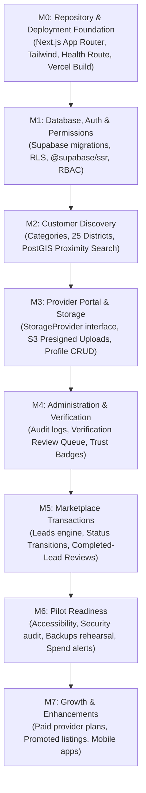

# Implementation Plan — Sri Lanka Local Services Finder (Vercel + Supabase + Vultr Object Storage)

**Status:** Authoritative Implementation Baseline  
**Date:** 12 November 2026 (Updated per `ANTIGRAVITY_ARCHITECTURE_VERCEL_VULTR_STORAGE_ONLY.md`)  
**Reference:** `ANTIGRAVITY_ARCHITECTURE_VERCEL_VULTR_STORAGE_ONLY.md`, `PROJECT_BLUEPRINT.md`, `AGENTS.md`

---

## 1. Executive Strategy & Simplified Architecture

The application uses the fewest managed services possible:
- **Application Hosting & Edge Delivery:** **Vercel** for all environments (Local, Preview, Production).
- **Database & Identity:** **Supabase** (PostgreSQL, PostGIS, Supabase Auth) in Singapore (`ap-southeast-1`).
- **Object Storage:** **Vultr Object Storage** (Singapore) S3-compatible, used **only** when the owner's promotional credits are confirmed to cover the subscription ($18/mo). Otherwise, Supabase Storage is used until switching is economical.
- **Source & Deployment:** GitHub connected to Vercel for preview and production deployments.
- **Explicit Non-Goals:** Zero Vultr Compute, zero VPS, zero Kubernetes, zero Docker, zero Docker Compose, zero Caddy, zero Nginx, zero Redis, zero microservices.

---

## 2. Milestone Roadmap (M0–M7)

---

### M0 — Repository and Deployment Foundation (Completed)
- **Scope:**
  - Next.js 16 App Router project with strict TypeScript.
  - Tailwind CSS with mobile-first accessible shell.
  - Safe environment validation (`src/lib/config/env.ts`).
  - Supabase client utilities for browser, Server Components, and middleware (`@supabase/ssr`).
  - `/api/health` probe route.
  - Responsive header, footer, and landing page shell.
  - Vitest unit testing setup with automated tests.
  - GitHub repository initialization and connection to `origin main`.
- **Status:** **COMPLETE** (pushed to `https://github.com/orionops1/localservicefinder.git`).

---

### M1 — Database, Authentication and Authorization
- **Scope:**
  - SQL migrations: `profiles`, `user_roles`, `businesses`, `business_members`, `service_categories`, Sri Lankan administrative taxonomy.
  - Enable `postgis` in `extensions` schema.
  - Supabase Auth SSR session management via cookie handling.
  - Role-Based Access Control (RBAC): `customer`, `provider_owner`, `provider_staff`, `moderator`, `verifier`, `admin`.
  - Row Level Security (RLS) policies on all day-one tables.
  - Fictional, clearly marked test seed data.
- **Status:** **COMPLETE** (migrations in `supabase/migrations/`, RLS policies in `20261112000002_rls_policies.sql`, seed data in `supabase/seed.sql`).

---

### M2 — Customer Discovery
- **Scope:**
  - Seed Sri Lankan location hierarchy: 9 Provinces, 25 Districts, initial localities with WGS84 centroids.
  - Seed launch service categories with EN/SI/TA labels and icons.
  - Responsive home page with keyword search and district/town picker.
  - PostGIS proximity query RPC (`search_providers_geo`).
  - Search results page (`/search`) with filtering (keyword, category, district, town, rating, verifiedOnly), sorting, pagination, and empty states.
  - Category catalog page (`/services`) and category detail page (`/services/[categorySlug]`).
  - Provider public profile pages (`/providers/[slug]`) with offered services, pricing indicators, coverage areas, portfolio samples, and direct contact options.
  - REST APIs: `/api/v1/search/providers`, `/api/v1/categories`, `/api/v1/locations`.
  - Unit tests for search service and location taxonomy (17 tests passing).
- **Status:** **COMPLETE** (all routes, APIs, and tests verified and compiling).

---

### M3 — Provider Portal and Storage
- **Scope:**
  - Multi-step provider onboarding wizard with save-and-resume.
  - Business profile editor, service catalogue manager, and coverage area selector.
  - Implement provider-neutral `StorageProvider` interface (`createUploadUrl`, `createDownloadUrl`, `deleteObject`, `getObjectMetadata`).
  - Implement `VultrS3StorageProvider` (if credits confirmed) and `SupabaseStorageProvider` (fallback).
  - Browser direct presigned PUT upload pipeline (large files never pass through Vercel functions).
  - Public/private bucket separation (`lsf-public-media` vs. `lsf-private-files`).
- **Acceptance Gate:** Authorized provider can upload portfolio media directly; one provider cannot access another provider's objects; private verification files are inaccessible to unauthorized users.

---

### M4 — Administration and Verification
- **Scope:**
  - Admin dashboard with real database counts.
  - Provider review queue (approve, reject with customer-safe explanation, request info).
  - Verification evidence review queue: inspect private documents via short-lived (5-min) presigned GET URLs.
  - Trust badge assignments (Phone confirmed, Identity checked, Business details checked, Qualification checked).
  - Structured immutable audit logging in `admin_audit_logs`.
- **Acceptance Gate:** Admin screens and API routes restricted to authenticated administrator roles; all sensitive actions audited; badges require recorded human review.

---

### M5 — Marketplace Transactions
- **Scope:**
  - Customer enquiry form on provider profile pages (`/api/v1/leads`).
  - Lead lifecycle finite state machine (`new` -> `viewed` -> `contacted` -> `quoted` -> `accepted` -> `in_progress` -> `completed`).
  - Tamper-evident transition history in `lead_status_events`.
  - Provider lead inbox with status updates.
  - Customer account area (`/customer/enquiries`, `/customer/favourites`).
  - Review submission engine: allowed only for completed leads (`UNIQUE(lead_id)`).
  - Review moderation queue.
- **Acceptance Gate:** Customer and provider lifecycle tests pass; unauthorized lead access blocked; duplicate or unverified reviews rejected.

---

### M6 — Pilot Readiness
- **Scope:**
  - Security review, WCAG 2.2 AA accessibility audit, responsive QA across mobile viewports.
  - Database backup and restore rehearsal.
  - PWA manifest (`manifest.webmanifest`), SEO metadata, `sitemap.ts`, `robots.ts`.
  - Vercel spend controls and Supabase/Vultr usage alerts.
  - Sri Lankan legal/privacy review check (Personal Data Protection Act No. 9 of 2022 / No. 22 of 2025).
- **Acceptance Gate:** Release checklist signed off; zero unresolved critical/high vulnerabilities; pilot launch readiness confirmed.

---

### M7 — Growth
- **Scope:**
  - Paid provider plans, promoted category listings, business accounts, and analytics after validated customer demand.
