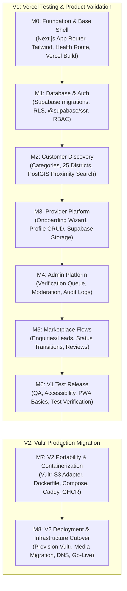

# Implementation Plan — Sri Lanka Local Services Finder (V1 Vercel → V2 Vultr)

**Status:** Authoritative Staged Implementation Baseline  
**Date:** 12 November 2026  
**Reference:** `ANTIGRAVITY_V1_VERCEL_V2_VULTR_PLAN.md`, `PROJECT_BLUEPRINT.md`, `AGENTS.md`, `docs/INFRASTRUCTURE_DECISION.md`

---

## 1. Executive Strategy & Staged Delivery

The platform implementation is staged to prioritize rapid product validation and end-to-end user journey verification on **Vercel** with **Supabase**, followed by an orderly infrastructure migration to **Vultr Cloud Compute + Caddy + Vultr Object Storage** for production:

1. **V1 (M0–M6):** Rapid development, live previews, and acceptance testing on Vercel backed by managed Supabase (PostgreSQL, PostGIS, Auth, and Storage). Docker is intentionally deferred to avoid premature operational friction.
2. **V2 (M7–M8):** Production migration to Vultr Cloud Compute in Singapore, utilizing Docker Compose, Caddy TLS, Vultr Object Storage (S3 adapter), and Cloudflare DNS. Vultr credits are preserved until this stage.
3. **Strict Portability:** All application code adheres to standard Node.js App Router conventions. Zero reliance on Vercel-only proprietary services (Blob, KV, Postgres, Edge Config, Edge Runtime). Storage access is strictly abstracted via `StorageService`.

---

## 2. Staged Milestone Roadmap (M0–M8)

---

### M0 — Foundation & Base Shell
- **Deployment Target:** Vercel Test Deployment.
- **Scope:**
  - Initialize clean Next.js 15+ App Router project with TypeScript (strict mode).
  - Setup package manager (pnpm), ESLint, and Prettier.
  - Setup Tailwind CSS with mobile-first accessible component foundation.
  - Establish environment validation (`src/lib/config/env.ts`) separating `NEXT_PUBLIC_*` from server secrets.
  - Supabase client wrappers (`@supabase/ssr`) for browser, Server Components, and Route Handlers.
  - Minimal, unauthenticated health route (`/api/health`) returning operational status without leaking credentials.
  - App shell with responsive navigation, header, footer, and language indicator.
  - Vercel deployment configuration (`vercel.json` if required) and local build verification (`pnpm build`).
- **Completion Evidence:**
  - Local development server runs cleanly.
  - `pnpm build` passes with zero type/lint errors.
  - `/api/health` returns HTTP 200 JSON.
  - Vercel test project connected or deployment checklist verified.
  - Zero Docker requirements or Vultr credit expenditures.

---

### M1 — Database, Auth & Permissions
- **Deployment Target:** Vercel + Dev Supabase.
- **Scope:**
  - Database migrations: `profiles`, `user_roles`, `businesses`, `business_members`.
  - Enable `postgis` in `extensions` schema.
  - Supabase Auth SSR integration (PKCE, cookie session handling via middleware).
  - Role-Based Access Control (RBAC): `customer`, `provider_owner`, `provider_staff`, `moderator`, `verifier`, `admin`.
  - Row Level Security (RLS) policies on day-one tables.
  - Seed taxonomy and test accounts (clearly marked as test data).
- **Completion Evidence:**
  - Migrations apply cleanly via Supabase CLI.
  - Auth flows (sign-up, sign-in, session recovery) work across server and client.
  - RLS tests prove customers cannot modify unauthorized profiles or access private records.

---

### M2 — Customer Discovery
- **Deployment Target:** Vercel.
- **Scope:**
  - Seed Sri Lankan location hierarchy: 9 Provinces, 25 Districts, curated localities.
  - Seed launch categories (Home & Property, Automotive, Personal Services, etc.) with EN/SI/TA labels.
  - Responsive home page with keyword search and district/town picker.
  - PostGIS proximity query RPC (`search_providers_geo`).
  - Search results page with filtering, sorting, pagination, and empty states.
  - Provider public profile page with offered services and coverage areas.
- **Completion Evidence:**
  - Search by service keyword and location returns active approved providers.
  - Draft, rejected, and suspended providers are excluded by database queries and RLS.
  - Location selection functions seamlessly without browser geolocation permission.

---

### M3 — Provider Platform
- **Deployment Target:** Vercel.
- **Scope:**
  - Provider onboarding wizard (`/provider/onboarding`) with save-and-resume.
  - Business profile editor, service catalogue manager, and coverage area selector.
  - Abstract `StorageService` interface; implement `SupabaseStorageService` for V1.
  - Provider media upload pipeline to `provider-public` bucket (logos, portfolio).
  - Provider dashboard overview (profile completion checklist, incoming lead counters).
- **Completion Evidence:**
  - Provider can register, edit services, upload photos, and submit for review.
  - Direct file upload to Supabase Storage succeeds via secure tokens.
  - Provider cannot access or edit other businesses' data.

---

### M4 — Admin Platform
- **Deployment Target:** Vercel.
- **Scope:**
  - Admin dashboard (`/admin`) with real database metrics.
  - Provider application queue (approve, reject with customer-safe reason, request info).
  - Verification review queue: inspect private evidence in `private-documents` bucket via short-lived signed URLs.
  - Granular trust badges: Phone confirmed, Identity checked, Business details checked, Qualification checked.
  - Immutable audit logging in `admin_audit_logs`.
- **Completion Evidence:**
  - Admin routes restricted to authenticated administrator roles on the server.
  - Verification documents are never exposed in public buckets.
  - All admin mutations generate structured audit records.

---

### M5 — Marketplace Flows
- **Deployment Target:** Vercel.
- **Scope:**
  - Customer enquiry submission form (`/api/v1/leads`).
  - Lead state machine (`new` -> `viewed` -> `contacted` -> `quoted` -> `accepted` -> `in_progress` -> `completed`).
  - Tamper-evident transition history in `lead_status_events`.
  - Provider lead inbox with filtering and status controls.
  - Customer account area (`/customer/enquiries`, `/customer/favourites`).
  - Reviews engine: reviews permitted only for completed leads (`UNIQUE(lead_id)`).
  - Review moderation queue.
  - Replaceable `NotificationService` adapter (in-app notifications + email stub).
- **Completion Evidence:**
  - Enquiries create isolated leads visible only to the customer and assigned provider.
  - Review submission blocked unless lead status is `completed`.
  - Duplicate reviews are rejected.

---

### M6 — V1 Test Release & Acceptance
- **Deployment Target:** Vercel.
- **Scope:**
  - Security audit: RLS policies, input sanitization, rate limits.
  - Accessibility audit (WCAG 2.2 AA target, keyboard navigation, contrast).
  - Responsive QA across mobile viewports (Android/iOS small screens).
  - PWA basics: `manifest.webmanifest`, app icons.
  - SEO basics: `robots.ts`, `sitemap.ts`, OpenGraph metadata.
  - Full end-to-end smoke test on Vercel preview deployment.
- **Completion Evidence:**
  - All automated checks pass (`lint`, `typecheck`, `test`, `build`).
  - Customer, provider, and admin journeys verified on Vercel test deployment.
  - V1 Release Report prepared for owner review.

---

### M7 — V2 Portability & Infrastructure Preparation
- **Deployment Target:** Local / Staging Docker.
- **Scope:**
  - Implement `VultrS3StorageService` under `StorageService`.
  - One-off media migration utility (Supabase Storage -> Vultr Object Storage).
  - Multi-stage production `Dockerfile` (Node.js LTS Debian-slim, non-root).
  - Production `compose.production.yaml` (`app` + `caddy:2-alpine`).
  - `Caddyfile` for TLS termination and reverse proxy.
  - GitHub Actions workflow for lint, test, build, and push to GHCR.
  - Staging smoke tests in local Docker Compose environment.
- **Completion Evidence:**
  - Application builds and runs in Docker standalone mode locally.
  - Storage adapter switches between `supabase` and `vultr-s3` via `STORAGE_PROVIDER` env variable.
  - No paid Vultr resources provisioned without explicit approval.

---

### M8 — V2 Deployment & Infrastructure Cutover
- **Deployment Target:** Vultr Cloud Compute (Singapore) + Supabase + Vultr Object Storage.
- **Scope:**
  - Owner-guided provisioning of Vultr Compute (minimum 2 GB RAM, Singapore) and Object Storage.
  - VM hardening (SSH keys only, firewall: ports 80/443 public, non-root user).
  - Media asset migration execution and verification.
  - Cloudflare DNS configuration and TLS verification.
  - Automated database backup script (`pg_dump` to `lsf-backups` bucket).
  - Production cutover and verification of critical customer/provider journeys.
- **Completion Evidence:**
  - Production application live on Vultr behind Caddy with valid TLS.
  - All assets serving reliably from Vultr Object Storage.
  - Zero downtime rollback plan verified.

---

## 3. Strict Operating Rules

1. **One Milestone at a Time:** Antigravity implements only the currently approved milestone.
2. **Preserve Vultr Credits:** Zero Vultr credit expenditure during V1.
3. **No Fake Data:** Never fabricate fake provider profiles, fake ratings, or fake reviews.
4. **Validation on the Server:** Client validation is for UX; server Zod schemas and RLS are mandatory.
