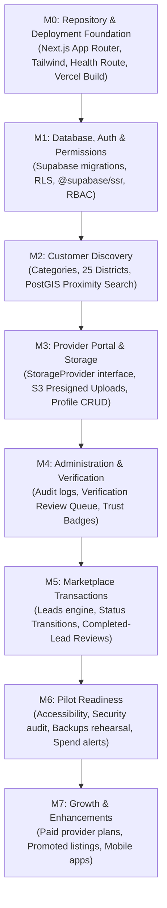

# Implementation Plan — Sri Lanka Local Services Finder (Vercel + Supabase + Vultr Object Storage)

**Status:** Authoritative Implementation Baseline  
**Date:** 12 November 2026 (Updated per `ANTIGRAVITY_ARCHITECTURE_VERCEL_VULTR_STORAGE_ONLY.md`)  
**Reference:** `ANTIGRAVITY_ARCHITECTURE_VERCEL_VULTR_STORAGE_ONLY.md`, `PROJECT_BLUEPRINT.md`, `AGENTS.md`

---

## 1. Executive Strategy & Simplified Architecture

The application uses the fewest managed services possible:
- **Application Hosting & Edge Delivery:** **Vercel** for all environments (Local, Preview, Production).
- **Database & Identity:** **Supabase** (PostgreSQL, PostGIS, Supabase Auth) in Singapore (`ap-southeast-1`).
- **Object Storage:** **Vultr Object Storage** (Singapore) S3-compatible, used **only** when the owner's promotional credits are confirmed to cover the subscription ($18/mo). Otherwise, Supabase Storage is used until switching is economical.
- **Source & Deployment:** GitHub connected to Vercel for preview and production deployments.
- **Explicit Non-Goals:** Zero Vultr Compute, zero VPS, zero Kubernetes, zero Docker, zero Docker Compose, zero Caddy, zero Nginx, zero Redis, zero microservices.

---

## 2. Milestone Roadmap (M0–M7)

---

### M0 — Repository and Deployment Foundation (Completed)
- **Scope:**
  - Next.js 16 App Router project with strict TypeScript.
  - Tailwind CSS with mobile-first accessible shell.
  - Safe environment validation (`src/lib/config/env.ts`).
  - Supabase client utilities for browser, Server Components, and middleware (`@supabase/ssr`).
  - `/api/health` probe route.
  - Responsive header, footer, and landing page shell.
  - Vitest unit testing setup with automated tests.
  - GitHub repository initialization and connection to `origin main`.
- **Status:** **COMPLETE** (pushed to `https://github.com/orionops1/localservicefinder.git`).

---

### M1 — Database, Authentication and Authorization
- **Scope:**
  - SQL migrations: `profiles`, `user_roles`, `businesses`, `business_members`, `service_categories`, Sri Lankan administrative taxonomy.
  - Enable `postgis` in `extensions` schema.
  - Supabase Auth SSR session management via cookie handling.
  - Role-Based Access Control (RBAC): `customer`, `provider_owner`, `provider_staff`, `moderator`, `verifier`, `admin`.
  - Row Level Security (RLS) policies on all day-one tables.
  - Fictional, clearly marked test seed data.
- **Status:** **COMPLETE** (migrations in `supabase/migrations/`, RLS policies in `20261112000002_rls_policies.sql`, seed data in `supabase/seed.sql`).

---

### M2 — Customer Discovery
- **Scope:**
  - Seed Sri Lankan location hierarchy: 9 Provinces, 25 Districts, initial localities with WGS84 centroids.
  - Seed launch service categories with EN/SI/TA labels and icons.
  - Responsive home page with keyword search and district/town picker.
  - PostGIS proximity query RPC (`search_providers_geo`).
  - Search results page (`/search`) with filtering (keyword, category, district, town, rating, verifiedOnly), sorting, pagination, and empty states.
  - Category catalog page (`/services`) and category detail page (`/services/[categorySlug]`).
  - Provider public profile pages (`/providers/[slug]`) with offered services, pricing indicators, coverage areas, portfolio samples, and direct contact options.
  - REST APIs: `/api/v1/search/providers`, `/api/v1/categories`, `/api/v1/locations`.
  - Unit tests for search service and location taxonomy (17 tests passing).
- **Status:** **COMPLETE** (all routes, APIs, and tests verified and compiling).

---

### M3 — Provider Portal and Storage
- **Scope:**
  - Multi-step provider onboarding wizard (`/provider/onboarding`) with save-and-resume.
  - Business profile editor (`/provider/profile`), service catalogue manager (`/provider/services`), and coverage area selector (`/provider/service-areas`).
  - Provider dashboard (`/provider/dashboard`) with real-time status banners, service metrics, and moderation indicators.
  - Verification & Trust evidence uploader (`/provider/verification`) for private identity (NIC), business registration (BR), and trade qualification documents.
  - Provider-neutral `StorageProvider` interface (`createUploadUrl`, `createDownloadUrl`, `deleteObject`, `getObjectMetadata`, `getPublicUrl`).
  - Implemented `VultrS3StorageProvider` (S3 client + presigner) and `SupabaseStorageProvider` (Supabase storage client).
  - Browser direct presigned PUT upload pipeline (`/api/v1/provider/upload/session` & `/api/v1/provider/upload/confirm`) preventing Vercel function payload exhaustion.
  - Public/private bucket separation (`lsf-public-media` vs. `lsf-private-files`).
  - Short-lived signed download route for private verification files (`/api/v1/provider/documents/[id]/download`).
  - Insert RLS policy migration and auto-membership trigger (`supabase/migrations/20261112000003_provider_portal_policies.sql`).
  - Comprehensive unit test suites (`tests/unit/storage.test.ts` & `tests/unit/provider-portal.test.ts`).
- **Status:** **COMPLETE** (34/34 tests passing, zero lint errors, Next.js production build verified).

---

### M4 — Customer Enquiries and Lead Management
- **Scope:**
  - Interactive customer enquiry modal and form on provider profile pages (`/providers/[slug]`).
  - Contact action tracking (`/api/v1/analytics/contact-tap`) recording direct phone calls and WhatsApp chats with minimal telemetry and zero PII leaks.
  - Lead lifecycle finite state machine (`new` -> `viewed` -> `contacted` -> `quoted` -> `accepted` -> `in_progress` -> `completed` / `declined` / `cancelled`).
  - Tamper-evident transition history in `lead_status_events` with automatic trigger `handle_lead_status_change()`.
  - Provider lead inbox (`/provider/leads`) with status filtering tabs, customer contact actions, and status transition buttons.
  - Customer account area: Active and completed enquiries (`/customer/enquiries`) and saved providers (`/customer/favourites`).
  - REST APIs: `/api/v1/leads`, `/api/v1/leads/[id]`, `/api/v1/favourites`, `/api/v1/analytics/contact-tap`.
  - Database migration: `supabase/migrations/20261112000004_lead_events_policies.sql`.
  - Unit tests: `tests/unit/leads-fsm.test.ts` verifying valid lifecycle progressions and rejection of illegal state transitions.
- **Status:** **COMPLETE** (40/40 tests passing, zero lint errors, Next.js production build verified across 25 routes).

---

### M5 — Admin Dashboard, Verification Queue and Moderation
- **Scope:**
  - Protected admin portal (`/admin`) with dark-mode navigation, platform metrics, and pending moderation alerts.
  - Platform overview metrics (total providers, approved providers, pending reviews, pending verifications, active marketplace leads).
  - Provider review console (`/admin/providers`) with multi-state filters (`pending_review`, `approved`, `rejected`), instant approval, and reasoned rejection workflows.
  - Verification evidence review console (`/admin/verifications`) with secure 5-minute presigned GET link generation for private document inspection (`NIC`, `BR`, vocational qualifications).
  - Trust badge allocation engine (`phone_confirmed`, `identity_checked`, `business_details_checked`, `qualification_checked`).
  - Immutable audit logging in `admin_audit_logs` and audit trail console (`/admin/audit-logs`).
  - REST APIs: `/api/v1/admin/overview`, `/api/v1/admin/providers/[id]/review`, `/api/v1/admin/verifications/[id]/review`, `/api/v1/admin/audit-logs`.
  - Comprehensive unit test suite (`tests/unit/admin-moderation.test.ts`).
- **Status:** **COMPLETE** (47/47 tests passing, zero lint errors, Next.js production build verified across 31 routes).

---

### M6 — Reviews, Notifications and Pilot Readiness
- **Scope:**
  - Review eligibility engine: reviews permitted strictly for completed leads (`UNIQUE(lead_id)`), preventing fake/unsolicited ratings.
  - Review moderation workflow: admin console (`/admin/reviews`) with filterable pending queue, approve/reject actions, and provider aggregate score recalculations (`rating_average`, `rating_count`).
  - Customer review submission modal integrated into customer enquiries portal (`/customer/enquiries`).
  - SMS & WhatsApp notification service abstraction (`src/features/notifications/notification-service.ts`) with Sri Lanka mobile number sanitization (`+94` format) and mock fallback.
  - PWA manifest (`manifest.webmanifest`), SEO metadata, dynamic `sitemap.xml`, and `robots.txt`.
  - Sri Lankan legal/privacy review check: Personal Data Protection Act (PDPA) No. 9 of 2022 compliance documentation (`docs/LEGAL_PRIVACY_PDPA.md`).
  - Comprehensive Pilot Launch Readiness Checklist (`docs/PILOT_LAUNCH_CHECKLIST.md`).
  - Unit test suite (`tests/unit/reviews-eligibility.test.ts`) covering eligibility checks, lead state constraints, rating aggregation, and notification formatting.
- **Acceptance Gate:** Release checklist verified; zero lint/typecheck errors; Next.js production build verified across 36 routes; 54/54 automated tests passing.
- **Status:** **COMPLETE**

---

### M7 — Growth
- **Scope:**
  - Paid provider plans, promoted category listings, business accounts, and analytics after validated customer demand.
