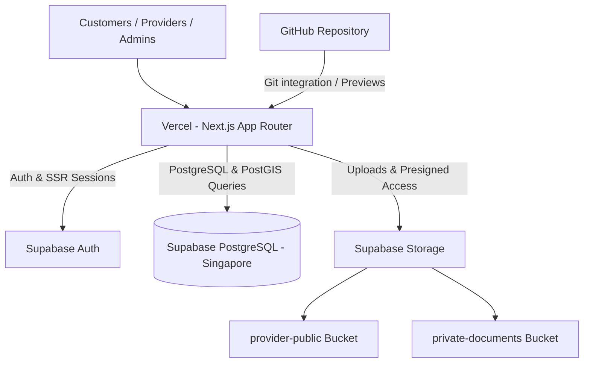
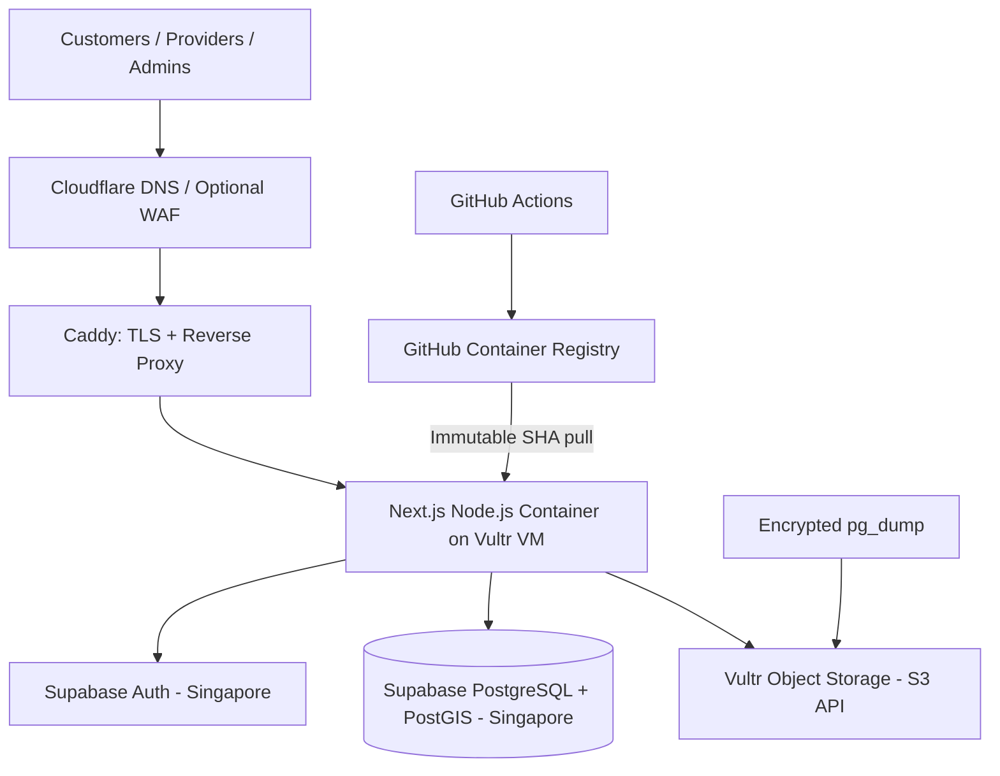

# Infrastructure Decision Record — Local Services Finder

**Status:** Approved Staged Decision (V1 Vercel Testing → V2 Vultr Production)  
**Decision date:** 12 November 2026 (Updated per Authoritative Directive)  
**Primary objective:** Accelerate testing and preview while preserving architectural portability, credit preservation, and production safety.

---

## 1. Staged Architecture Summary

The infrastructure rollout follows a strict two-stage strategy:

### Stage 1 (V1) — Build, Preview & Test (Current Focus)
- **Application:** Next.js App Router, React, and TypeScript deployed to **Vercel** via GitHub integration.
- **Database & Identity:** **Supabase** managed PostgreSQL, PostGIS, and Supabase Auth (`@supabase/ssr`) in Singapore (`ap-southeast-1`).
- **File Storage:** **Supabase Storage** (public bucket for approved media, private bucket with signed URLs for verification documents).
- **Runtime:** Standard Node.js runtime (no proprietary Edge Runtime or Vercel-specific storage in core paths).
- **Vultr Credits:** Zero consumption during V1; preserved untouched for V2.
- **Docker:** Not a deployment dependency for V1. Standard Node.js build on Vercel.

### Stage 2 (V2) — Production Infrastructure Migration
- **Application:** Next.js standalone container on **Vultr Cloud Compute** in Singapore (`sgp`), minimum 2 GB RAM.
- **Reverse Proxy / TLS:** **Caddy** on the VM, orchestrated with **Docker Compose**.
- **Database & Identity:** Unchanged — continues on **Supabase** (PostgreSQL, PostGIS, Auth). No self-hosted database on the VM.
- **File Storage:** Migrated to **Vultr Object Storage** (`https://sgp1.vultrobjects.com`) via S3 adapter behind the provider-neutral `StorageService` interface.
- **CI/CD:** **GitHub Actions** + **GitHub Container Registry (GHCR)** building immutable commit-SHA images.
- **DNS / Edge Security:** **Cloudflare DNS**; proxy/WAF enabled only after origin TLS and client IP validation.

---

## 2. Architecture Diagrams

### 2.1 V1 Architecture (Testing & Preview)


### 2.2 V2 Architecture (Production Migration)


---

## 3. Storage Abstraction & Portability

The core portability requirement between V1 and V2 is handled by the provider-neutral `StorageService` interface:

```ts
export type StorageVisibility = "public" | "private";

export interface StorageObjectInput {
  bucket: string;
  path: string;
  contentType: string;
  sizeBytes: number;
}

export interface StorageService {
  createUploadUrl(input: StorageObjectInput): Promise<{
    uploadUrl: string;
    objectPath: string;
    expiresAt: string;
    requiredHeaders?: Record<string, string>;
  }>;
  createDownloadUrl(input: {
    bucket: string;
    path: string;
    expiresInSeconds: number;
  }): Promise<{ url: string; expiresAt: string }>;
  deleteObject(input: { bucket: string; path: string }): Promise<void>;
  getPublicUrl(input: { bucket: string; path: string }): string | null;
}
```

- In **V1**, `SupabaseStorageService` implements this interface using `@supabase/supabase-js`.
- In **V2**, `VultrS3StorageService` implements this interface using `@aws-sdk/client-s3`.
- Application features (`providers`, `verification`, `portfolio`) interact **only** with `StorageService`, ensuring zero code changes in domain logic during migration.

---

## 4. Cost Model & Credit Preservation Rules

1. **Vultr Credit Protection:** Do not provision compute instances or object storage during V1. Preserve credits until M7/M8.
2. **Supabase Sizing:** Use Supabase Free for initial development and V1 test verification. Upgrade production project to Supabase Pro ($25/mo) before onboarding public customers.
3. **Vercel Plan Compliance:** Verify testing usage against Vercel terms. The test deployment is for validation and preview; commercial public traffic will reside on V2 Vultr infrastructure.

---

## 5. Decision Log & Revisions

| Date | Authority | Revision |
|---|---|---|
| 11 Nov 2026 | Initial Architecture Baseline | Vultr-first Docker deployment proposed as initial baseline. |
| 12 Nov 2026 | Authoritative Directive (`ANTIGRAVITY_V1_VERCEL_V2_VULTR_PLAN.md`) | Staged decision approved: V1 on Vercel + Supabase for preview and rapid testing; V2 migration to Vultr Compute + Caddy + Vultr S3 storage for production. |
