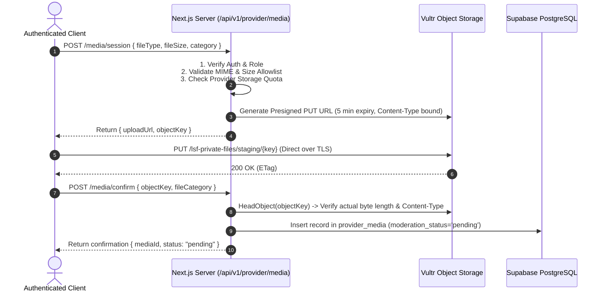

# Security & Privacy Architecture — Sri Lanka Local Services Finder

**Status:** Security Baseline & Compliance Standard  
**Date:** 11 November 2026  
**Reference:** `PROJECT_BLUEPRINT.md`, `AGENTS.md`, `docs/INFRASTRUCTURE_DECISION.md`

---

## 1. Threat Model & Data Classification

The platform handles both publicly discoverable commercial information and sensitive personal data. Data is categorized into four protection tiers:

| Tier | Classification | Examples | Storage Location | Protection Mechanisms |
|---|---|---|---|---|
| **Tier 1** | **Public Commercial** | Provider name, business description, service list, general town/district, public phone/WhatsApp, approved portfolio photos, published reviews | PostgreSQL `public` tables, Vultr `lsf-public-media` bucket | Read access open to anonymous and authenticated users; write restricted to authorized provider members or admins |
| **Tier 2** | **Confidential Customer PII** | Customer full name, private email, personal phone, enquiry message details, customer home address | PostgreSQL `leads`, `profiles` | Encrypted in transit; protected by Supabase RLS; accessible only to the customer who created it and the assigned provider |
| **Tier 3** | **Restricted Identity & Verification** | National Identity Card (NIC), passport, business registration certificate, qualification diplomas, internal verifier notes | Vultr `lsf-private-files` bucket, PostgreSQL `verification_submissions` | S3 bucket is private by default; access requires admin/verifier role; files served exclusively via 5-minute presigned GET URLs |
| **Tier 4** | **Operational & Platform Secrets** | Database passwords, Supabase secret service keys, S3 secret access keys, Sentry auth tokens, admin audit logs | Server environment files (`.env.production`), `admin_audit_logs` | Never stored in Git or client bundles; audit logs are append-only; secrets restricted to root/deploy user on VM |

---

## 2. Authentication & Session Security

- **Authentication Engine:** Supabase Auth using modern `@supabase/ssr` with PKCE flow.
- **Session Tokens:** Auth session tokens (`access_token`, `refresh_token`) are stored in secure, `HttpOnly`, `SameSite=Lax`, `Secure` cookies.
- **Client Bundle Protection:** Session tokens, service role keys, and database connection strings are never exposed to browser JavaScript or stored in `localStorage` or `sessionStorage`.
- **Credential Rotation:** Supabase JWT secret and S3 API credentials can be rotated without rebuilding container images since they are injected at runtime via environment variables.

---

## 3. Authorization & Row Level Security (RLS) Policy Matrix

Row Level Security is enabled on **every** table exposed in the Supabase schema from day one. Client queries execute with the authenticated user's JWT context (`auth.uid()`).

```
+---------------------------+-----------+------------+------------------+------------------+-----------------+
| Table                     | Anonymous | Customer   | Provider Owner   | Provider Staff   | Admin/Verifier  |
+---------------------------+-----------+------------+------------------+------------------+-----------------+
| profiles                  | None      | Own only   | Own only         | Own only         | Read/Audit      |
| user_roles                | None      | Own read   | Own read         | Own read         | Read/Write      |
| businesses (approved)     | Read only | Read only  | Read/Write (own) | Read (if perm)   | Read/Write      |
| businesses (draft/review) | None      | None       | Read/Write (own) | Read (if perm)   | Read/Write      |
| business_members          | None      | None       | Read/Write (own) | Read (own)       | Read/Write      |
| provider_services         | Read only | Read only  | Read/Write (own) | Read/Write (own) | Read/Write      |
| provider_service_areas    | Read only | Read only  | Read/Write (own) | Read/Write (own) | Read/Write      |
| provider_media (approved) | Read only | Read only  | Read/Write (own) | Read/Write (own) | Read/Write      |
| verification_submissions  | None      | None       | Read own status  | None             | Read/Write/Decide|
| leads                     | None      | Own only   | Assigned business| Assigned business| Read only (audit)|
| lead_status_events        | None      | Own leads  | Assigned business| Assigned business| Read only        |
| reviews (published)       | Read only | Read only  | Read only        | Read only        | Read/Moderate   |
| reviews (pending)         | None      | Own read   | None             | None             | Read/Moderate   |
| favourites                | None      | Own only   | None             | None             | None            |
| admin_audit_logs          | None      | None       | None             | None             | Read only (admin)|
+---------------------------+-----------+------------+------------------+------------------+-----------------+
```

### Authorization Enforcement Rules:
1. UI checks are for user experience only. Server components, API route handlers, and database RLS enforce all security boundaries.
2. Provider ownership is verified via `business_members` where `business_members.user_id = auth.uid()` and `business_members.status = 'active'`.
3. Administrative operations require a verified role in `user_roles` matching `admin`, `super_admin`, `moderator`, or `verifier`.

---

## 4. Storage Security & File Upload Pipeline

Direct browser-to-server uploads of untrusted binary files are prohibited to protect the web server from resource exhaustion and buffer overflows.

### Secure Presigned Upload Lifecycle


### Storage Protection Rules:
- **Allowlisted MIME Types:**
  - Public Media: `image/jpeg`, `image/png`, `image/webp` (Max 5 MB).
  - Verification Documents: `image/jpeg`, `image/png`, `image/webp`, `application/pdf` (Max 10 MB).
  - Executable files (`.exe`, `.sh`, `.bat`), scriptable formats (`.html`, `.svg` without strict sanitization), and archives (`.zip`, `.tar`) are rejected.
- **Opaque Object Keys:** Object keys use random UUIDv4 names (e.g., `uploads/biz_a1b2c3/8f4d92a1-1234-4a5b-9c8d-123456789abc.webp`). User-supplied file names are discarded.
- **Private Document Access:** Verification documents reside in `lsf-private-files`. Only verified administrators can request a temporary presigned GET URL (maximum TTL 300 seconds).

---

## 5. Network, Host & Edge Security

### Host Level (Vultr Cloud Compute)
- **SSH Hardening:**
  - Key-based authentication only. Password authentication and root login disabled (`PermitRootLogin no`, `PasswordAuthentication no`).
  - SSH port restricted to trusted management IPs via Vultr Firewall where practical.
- **Port Exposure:**
  - Publicly exposed ingress ports: **TCP 80** and **TCP 443** only.
  - Internal port 3000 (Next.js) is bound to Docker internal bridge network and never exposed on public host interfaces (`0.0.0.0:3000`).
  - Supabase database ports (5432) and Docker daemon socket are never exposed publicly.
- **Container Isolation:**
  - Next.js application container runs as a dedicated non-root user (`USER nextjs` with UID/GID 1001).
  - Read-only container root filesystem where applicable, using `/tmp` for ephemeral caching.

### Edge & Reverse Proxy (Caddy & Cloudflare)
- **Automatic TLS:** Caddy terminates TLS with modern cipher suites (TLS 1.2 / TLS 1.3), automated certificate renewal via Let's Encrypt / ZeroSSL.
- **Security Headers Enforced by Caddy:**
  - `Strict-Transport-Security: max-age=31536000; includeSubDomains; preload`
  - `X-Content-Type-Options: nosniff`
  - `X-Frame-Options: SAMEORIGIN`
  - `Referrer-Policy: strict-origin-when-cross-origin`
  - `Permissions-Policy: camera=(), microphone=(), payment=()`
  - Content Security Policy (CSP) restricting script execution and frame embedding.
- **Cloudflare Edge Validation:**
  - Cloudflare starts in DNS-only mode until Caddy certificate issuance and reverse proxy routing are verified.
  - When Cloudflare proxy is enabled, SSL/TLS mode is set to **Full (strict)**, and Caddy is configured to trust Cloudflare IP ranges for `X-Forwarded-For` real client IP extraction.

---

## 6. Sri Lankan Data Protection & Privacy Compliance

The platform is designed to align with the **Personal Data Protection Act No. 9 of 2022 (PDPA)**, as amended by the **Personal Data Protection (Amendment) Act No. 22 of 2025**.

### Key Compliance Mechanisms:
1. **Lawful Processing & Consent:** Clear, affirmative consent is collected at the point of customer enquiry and provider registration, explaining how data is shared.
2. **Data Minimization:**
   - Tradespersons' private residential addresses and exact coordinates are never published publicly. Only town/district coverage is visible.
   - Contact tracking (`contact_events`) records anonymous, aggregated click counters without logging personal customer identities.
3. **Data Subject Rights:**
   - Account closure and erasure requests are supported via customer settings (`/account/settings`).
   - Private identity verification records are retained for auditing/compliance during the active provider relationship, with a defined retention schedule (e.g., deleted 12 months after account termination, unless legally mandated).
4. **Cross-Border Transfers:** Database and object storage reside in Singapore (`sgp` / `ap-southeast-1`), selected for regional proximity, technical maturity, and strict data center security standards (ISO 27001, SOC 2).

---

## 7. Audit Logging & Tamper Resistance

All sensitive mutations must create immutable audit records in `admin_audit_logs`:
- **Audited Events:**
  - Provider application approval, rejection, or suspension.
  - Review moderation (approval, dismissal, deletion).
  - Verification check decisions and badge assignments.
  - User role assignment or revocation.
  - Manual data correction or override.
- **Audit Schema Fields:** `id`, `actor_id`, `action`, `target_type`, `target_id`, `before_data`, `after_data`, `reason`, `ip_address`, `created_at`.
- **Tamper Resistance:** RLS policies allow `INSERT` and `SELECT` by authorized administrators; `UPDATE` and `DELETE` on `admin_audit_logs` are prohibited.

---

## 8. Vulnerability Management & Incident Response

1. **Dependency Scanning:** Run `pnpm audit` in CI pipelines; block releases on high or critical severity CVEs.
2. **Secret Detection:** Enforce pre-commit hooks and CI checks to prevent accidental commit of `.env`, private keys, or credentials.
3. **Emergency Secret Rotation Plan:** Documented procedure to rotate Supabase API keys, Vultr S3 access keys, and SSH host keys within 30 minutes in the event of suspected compromise.
4. **Security Vulnerability Reporting:** Maintain `security@localservicefinder.lk` (or designated contact) with a public `security.txt` file at `/.well-known/security.txt`.
